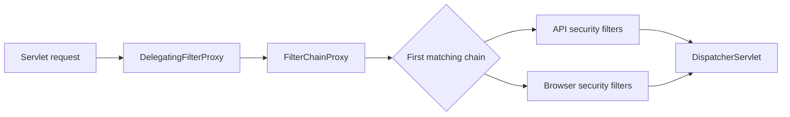

# 10. Spring Security

> Questions 236–260. Examples target Java 21, Spring Boot 3.5, and Spring Security 6.5 (servlet stack).

## Example setup

Use `spring-boot-starter-security`, `spring-boot-starter-web`, and, for token validation, `spring-boot-starter-oauth2-resource-server` under the Boot dependency manager. OIDC login additionally needs `spring-boot-starter-oauth2-client`. These are alternative examples: **do not register every chain/decoder from this document in one application**.

Java fragments are labelled as configuration-class members or type declarations. Add the relevant imports from this list; standalone programs include their own imports. Each API example that disables CSRF assumes **only explicit Authorization-header bearer authentication**, with no accepted session/cookie or automatically sent HTTP Basic credentials. Session examples keep CSRF enabled.

```java
import java.time.*;
import java.util.*;
import java.sql.*;
import org.springframework.beans.factory.annotation.Value;
import org.springframework.context.annotation.Bean;
import org.springframework.context.annotation.Configuration;
import org.springframework.core.annotation.Order;
import org.springframework.http.HttpMethod;
import org.springframework.security.authentication.*;
import org.springframework.security.authentication.AnonymousAuthenticationToken;
import org.springframework.security.config.Customizer;
import org.springframework.security.config.annotation.method.configuration.EnableMethodSecurity;
import org.springframework.security.config.annotation.web.builders.HttpSecurity;
import org.springframework.security.config.http.SessionCreationPolicy;
import org.springframework.security.core.Authentication;
import org.springframework.security.core.authority.SimpleGrantedAuthority;
import org.springframework.security.access.prepost.PreAuthorize;
import org.springframework.security.crypto.bcrypt.BCryptPasswordEncoder;
import org.springframework.security.crypto.password.PasswordEncoder;
import org.springframework.security.oauth2.core.*;
import org.springframework.security.oauth2.jose.jws.SignatureAlgorithm;
import org.springframework.security.oauth2.jwt.*;
import org.springframework.security.oauth2.server.resource.authentication.*;
import org.springframework.security.web.SecurityFilterChain;
import org.springframework.stereotype.Service;
import org.springframework.web.cors.*;
```

Real issuers, keys, users, and endpoints must be provisioned for integration. Source-level compilation alone does not prove login, signature validation, or deployment security.

## 236. What is Spring Security?

**1. Question:**

What is Spring Security?

**2. Difficulty:**

Basic

**3. Topic:**

Spring Security → Framework overview

**4. What interviewer is testing:**

Understanding the distinction between establishing identity, enforcing access, and protecting browser requests.

**5. Short interview answer (30–60 seconds):**

Spring Security handles authentication, authorization, and web security concerns in a Spring application. In a servlet application it intercepts requests through filters, builds a security context, and evaluates access rules before controllers run. I configure a SecurityFilterChain for URL rules and method security for sensitive service operations. It integrates with sessions, password-based login, OAuth clients, and resource servers; secure application design is still my responsibility.

**6. Detailed explanation:**

Authentication creates a trusted principal and authorities. Authorization applies rules to that identity. The framework also provides CSRF protection, security headers, session handling, and integration points. Different applications need different authentication mechanisms: a server-rendered browser app can use login plus a session, while a bearer-only API can validate access tokens.

**7. How it works internally:**

The servlet container calls DelegatingFilterProxy, which delegates to Spring's FilterChainProxy. It selects a matching SecurityFilterChain; its filters authenticate and authorize. SecurityContextHolder makes the identity available during processing and is cleared at the request boundary.

**8. Example:**

A catalog permits anonymous GETs to public product pages but requires login for account pages. An unauthenticated browser reaching a protected page is redirected to login; an authenticated user can proceed.

**9. Code example:**

```java
@Bean
SecurityFilterChain catalogSecurity(HttpSecurity http) throws Exception {
    http.authorizeHttpRequests(auth -> auth
            .requestMatchers("/", "/products/**").permitAll()
            .anyRequest().authenticated())
        .formLogin(Customizer.withDefaults());
    return http.build();
}
```

**Explanation / expected result:** This configuration is a class-body fragment in an @Configuration class. Public paths are anonymous; other paths use form login. Actual user authentication requires a UserDetailsService or another configured provider. CSRF remains enabled.

**10. Time & space complexity:**

For F configured filters and R sequential authorization matchers, framework work is roughly O(F + R), excluding password hashing, database queries, and downstream I/O. Session storage grows with active sessions; there is no universal O(1) security guarantee.

**11. Real-world/project usage:**

Protect account pages and purchase actions in a Spring MVC storefront without implementing login/session filters manually.

**12. Common mistakes:**

Removing all security filters for public URLs instead of permitAll; assuming URL protection checks row ownership; treating defaults as a complete security policy.

**13. Advantages:**

Consistent security integration and reusable authentication components reduce custom credential-processing code.

**14. Limitations:**

Misconfigured matchers or authorization rules can still expose endpoints. Framework protection does not fix SQL injection or unsafe business logic.

**15. Comparison with related concepts:**

Spring Security supplies security infrastructure; Spring Boot helps configure it. Authentication proves identity, while authorization checks the requested action.

**16. Production considerations:**

Test anonymous, allowed, and forbidden requests. Keep the login page reachable, retain CSRF for session-based writes, and require HTTPS at the edge.

**17. Possible follow-up questions:**

1. What is the SecurityContext?
2. What does permitAll do?
3. What is the difference between form login and a resource server?

**18. Senior-level follow-up questions:**

1. Where should ownership checks live?
2. How do you prevent an unmatched URL from bypassing security?

**19. Scenario-based question:**

**Scenario:** Public pages work, but private pages are exposed. **Answer:** Check matcher order and the selected chain, replace broad permit rules with narrow ones, and add tests for every protected route.

**20. One-line revision note:**

Spring Security authenticates requests and enforces access through filters and optional method interceptors.

**21. Image visuals (if required):**

No additional visual needed; the example and execution sequence above show the relevant behavior.

---

## 237. Authentication vs authorization?

**1. Question:**

Authentication vs authorization?

**2. Difficulty:**

Basic

**3. Topic:**

Spring Security → Authentication and authorization

**4. What interviewer is testing:**

Separating credential verification from permission checks, including correct API failure semantics.

**5. Short interview answer (30–60 seconds):**

Authentication answers who the caller is; authorization answers whether that caller may perform an action. A valid token can authenticate a user without granting administrator access. In a bearer API, missing or invalid credentials usually produce 401, while an authenticated caller lacking a required permission receives 403. I apply authorization at both endpoint and business-object boundaries so one user cannot access another user's data.

**6. Detailed explanation:**

Authentication yields a principal and authorities from a trusted source. Authorization evaluates those authorities plus relevant context, such as resource ownership. A role check alone does not prove ownership. Browser form-login applications may redirect unauthenticated users rather than return an API-style 401.

**7. How it works internally:**

An AuthenticationProvider verifies credentials and returns an authenticated Authentication. An AuthorizationManager later examines it against a rule. A denied unauthenticated request invokes an entry point; a denied authenticated request normally invokes an access-denied handler.

**8. Example:**

A logged-in employee may view their account but not /admin/reports. A valid identity is necessary but insufficient for that administrative endpoint.

**9. Code example:**

```java
static boolean mayReadAdminReport(Authentication authentication) {
    if (authentication == null || !authentication.isAuthenticated()
            || authentication instanceof AnonymousAuthenticationToken) {
        return false;
    }
    return authentication.getAuthorities().stream()
        .anyMatch(a -> a.getAuthority().equals("ROLE_ADMIN"));
}
```

**Explanation / expected result:** This class-body utility checks a granted authority; it is illustrative and is not a substitute for endpoint or method security. AnonymousAuthenticationToken is excluded explicitly because it can report isAuthenticated=true.

**10. Time & space complexity:**

The example's authority scan costs O(A), where A is the authority count; auxiliary space is O(1). Actual token verification or user lookup adds separate costs.

**11. Real-world/project usage:**

Separate login failures from permission failures in support dashboards and keep ownership rules in account services.

**12. Common mistakes:**

Trusting roles supplied by the client; using isAuthenticated alone as an object-access rule; treating every security rejection as 401.

**13. Advantages:**

Independent identity and policy components allow new login mechanisms without rewriting every access rule.

**14. Limitations:**

Stale authority information in long-lived sessions or tokens can delay permission changes.

**15. Comparison with related concepts:**

Authentication is credential verification. Authorization is policy evaluation. Auditing records both, but does not itself grant access.

**16. Production considerations:**

Use a trusted authority source, audit denied sensitive actions, and define how role revocation propagates to active sessions or tokens.

**17. Possible follow-up questions:**

1. Can an authenticated user get 403?
2. What is an anonymous Authentication?
3. How are authorities loaded?

**18. Senior-level follow-up questions:**

1. How do you handle immediate permission revocation?
2. How do you distinguish tenant access from role access?

**19. Scenario-based question:**

**Scenario:** A valid JWT reaches an admin endpoint and receives 403. **Answer:** Verify the mapped authorities and policy; do not weaken the policy merely because signature verification succeeded.

**20. One-line revision note:**

Authentication proves identity; authorization checks the requested action and resource.

**21. Image visuals (if required):**

No additional visual needed; the example and execution sequence above show the relevant behavior.

---

## 238. How does Spring Security's filter chain work?

**1. Question:**

How does Spring Security's filter chain work?

**2. Difficulty:**

Advanced

**3. Topic:**

Spring Security → Servlet filter architecture

**4. What interviewer is testing:**

Knowing request interception, chain selection, ordering, and the distinction between servlet and Spring filters.

**5. Short interview answer (30–60 seconds):**

Spring Security runs before the controller through a servlet filter delegation mechanism. FilterChainProxy selects the first matching SecurityFilterChain and executes its filters in their configured order. These handle context, authentication, exploit protection, and authorization as applicable. A filter can reject the request or continue processing. Multiple chains do not all run, so both chain order and request matchers matter.

**6. Detailed explanation:**

DelegatingFilterProxy bridges the servlet container and Spring beans. FilterChainProxy owns the security chains. Exact filters depend on configuration: form login and JWT resource-server configurations use different authentication filters. SecurityContext cleanup prevents identity leaking between requests on reused threads.

**7. How it works internally:**

Request → DelegatingFilterProxy → FilterChainProxy → first matching chain → configured filters → application servlet. The response unwinds through the filters. No matching chain means Spring Security does not protect that request.

**8. Example:**

An /api/** request matches the resource-server chain. A browser page matches a fallback form-login chain. It does not run both authentication mechanisms sequentially.

**9. Code example:**

```java
@Bean
@Order(1)
SecurityFilterChain apiChain(HttpSecurity http) throws Exception {
    http.securityMatcher("/api/**")
        .csrf(csrf -> csrf.disable())
        .sessionManagement(s -> s.sessionCreationPolicy(SessionCreationPolicy.STATELESS))
        .authorizeHttpRequests(a -> a.anyRequest().authenticated())
        .oauth2ResourceServer(o -> o.jwt(Customizer.withDefaults()));
    return http.build();
}

@Bean
@Order(2)
SecurityFilterChain browserChain(HttpSecurity http) throws Exception {
    http.authorizeHttpRequests(a -> a.anyRequest().authenticated())
        .formLogin(Customizer.withDefaults());
    return http.build();
}
```

**Explanation / expected result:** Two @Bean methods belong in one configuration class. The API accepts bearer JWTs only, so CSRF is disabled for that chain; the browser chain retains CSRF. A JwtDecoder or issuer configuration is required for the API.

**10. Time & space complexity:**

Matching C chains and executing F filters costs O(C + F) in a simple linear configuration, plus filter-specific work. Context storage is request-scoped or session-dependent.

**11. Real-world/project usage:**

Use separate API and browser chains in an application serving both machine clients and an administrative UI.

**12. Common mistakes:**

Assuming every chain runs; putting a broad matcher first; registering a custom filter as both a servlet filter and a security filter.

**13. Advantages:**

Ordered extension points make authentication and web protection reusable across endpoints.

**14. Limitations:**

Incorrect chain ordering can silently select the wrong authentication mechanism or leave paths uncovered.

**15. Comparison with related concepts:**

A servlet FilterChain includes all container filters. A SecurityFilterChain contains the Spring security filters for one matched request configuration.

**16. Production considerations:**

Inspect debug filter-chain logs in a controlled environment, test each URL family, and avoid logging credentials while diagnosing selection.

**17. Possible follow-up questions:**

1. Which chain runs first?
2. How do you position a custom filter?
3. What happens if no chain matches?

**18. Senior-level follow-up questions:**

1. How do you prevent duplicate custom-filter execution?
2. How do async and error dispatches affect filter behavior?

**19. Scenario-based question:**

**Scenario:** /api/orders redirects to an HTML login page. **Answer:** Check whether a broad form-login chain precedes the API chain, correct ordering/matchers, and test that unauthenticated API requests return 401.

**20. One-line revision note:**

Only the first matching SecurityFilterChain runs for a request.

**21. Image visuals (if required):**



---

## 239. What is SecurityFilterChain?

**1. Question:**

What is SecurityFilterChain?

**2. Difficulty:**

Intermediate

**3. Topic:**

Spring Security → SecurityFilterChain configuration

**4. What interviewer is testing:**

Modern bean-based HTTP security configuration and safe rule ordering.

**5. Short interview answer (30–60 seconds):**

A SecurityFilterChain defines which requests a security configuration matches and which filters protect them. I declare it as a bean, configure HttpSecurity, and return http.build(). securityMatcher selects the chain; requestMatchers defines authorization inside that chain. I place specific rules before broad ones and include a fallback policy so unexpected endpoints do not become public.

**6. Detailed explanation:**

The chain contains a RequestMatcher and an ordered filter list. Defining a custom bean changes Boot's default security setup; authentication providers or a decoder still need configuration. WebSecurityConfigurerAdapter is not used in Spring Security 6.

**7. How it works internally:**

HttpSecurity collects configurers and shared objects, then builds the chain. FilterChainProxy later applies its matcher. authorizeHttpRequests adds authorization decisions for requests already assigned to this chain.

**8. Example:**

Permit only GET /health, protect /admin/** with ADMIN, and deny all other requests until explicitly approved.

**9. Code example:**

```java
@Bean
SecurityFilterChain explicitRoutes(HttpSecurity http) throws Exception {
    http.authorizeHttpRequests(a -> a
            .requestMatchers(HttpMethod.GET, "/health").permitAll()
            .requestMatchers("/admin/**").hasRole("ADMIN")
            .anyRequest().denyAll())
        .formLogin(Customizer.withDefaults());
    return http.build();
}
```

**Explanation / expected result:** This browser/session example keeps CSRF and uses form login. GET /health is anonymous; administrators can reach /admin/**; other routes are denied.

**10. Time & space complexity:**

For R authorization matchers, matching may be O(R). Filter execution, authentication, and endpoint logic add separate costs; the bean is built at startup.

**11. Real-world/project usage:**

Make a service's externally accessible routes explicit during API review.

**12. Common mistakes:**

Confusing securityMatcher with requestMatchers; placing anyRequest first; using permitAll as a catch-all; expecting the bean to create users automatically.

**13. Advantages:**

Readable, composable configuration makes security policy reviewable alongside application code.

**14. Limitations:**

A chain only governs requests it matches. Multiple chains require intentional order and full coverage.

**15. Comparison with related concepts:**

securityMatcher chooses the chain; requestMatchers chooses authorization within that chain. permitAll keeps security filters active, unlike ignoring requests entirely.

**16. Production considerations:**

Add negative-route tests for unexpected endpoints and monitor unauthorized traffic without exposing sensitive route details.

**17. Possible follow-up questions:**

1. What is denyAll?
2. How does matcher order work?
3. What changes when a custom chain bean is declared?

**18. Senior-level follow-up questions:**

1. How do you secure actuator separately?
2. How do you test that new routes are denied by default?

**19. Scenario-based question:**

**Scenario:** A newly added endpoint is publicly reachable. **Answer:** Replace permissive fallback rules with denyAll or authenticated as appropriate and add route-coverage tests.

**20. One-line revision note:**

SecurityFilterChain is the bean defining request matching and ordered security behavior.

**21. Image visuals (if required):**

No additional visual needed; the example and execution sequence above show the relevant behavior.

---

## 240. What is JWT?

**1. Question:**

What is JWT?

**2. Difficulty:**

Basic

**3. Topic:**

Spring Security → Tokens → JWT

**4. What interviewer is testing:**

Recognizing token integrity, readability, and the difference between a token format and a login protocol.

**5. Short interview answer (30–60 seconds):**

A JWT carries claims in a compact representation. Common API access tokens are signed JWTs: their signature protects integrity, but their payload is readable, not confidential. A resource server verifies the signature and relevant claims before trusting the identity. JWT is a token format, not an authorization protocol, and immediate revocation requires extra design rather than assuming a signed token can never be revoked.

**6. Detailed explanation:**

JWT claims can identify issuer, subject, audience, and validity period. A signed JWS typically has three dot-separated segments; encrypted JWTs use JWE and a different structure. Claims are not evidence until verification succeeds. Large or sensitive data does not belong in an access token.

**7. How it works internally:**

The issuer serializes a header and claims, signs the encoded input, and sends the token. The recipient selects a trusted verification key, checks the signature and claims, and only then maps the subject and authorities.

**8. Example:**

An order service accepts a token issued for orders-api; it rejects a token issued for another API even if signed by the same identity provider.

**9. Code example:**

```java
@Bean
SecurityFilterChain jwtResourceServer(HttpSecurity http) throws Exception {
    http.csrf(c -> c.disable())
        .sessionManagement(s -> s.sessionCreationPolicy(SessionCreationPolicy.STATELESS))
        .authorizeHttpRequests(a -> a.anyRequest().authenticated())
        .oauth2ResourceServer(o -> o.jwt(Customizer.withDefaults()));
    return http.build();
}
```

**Explanation / expected result:** HttpSecurity enables resource-server validation; YAML supplies a trusted issuer. These are separate configuration fragments, not a token-issuing implementation. The audience must also be checked, as shown in question 244.

**10. Time & space complexity:**

Parsing costs O(L) for token length L; signature verification depends on algorithm and key size. Cached keys avoid a network call per request. Tokens consume bandwidth on every call.

**11. Real-world/project usage:**

Validate access tokens in microservices while keeping signing keys at the authorization server.

**12. Common mistakes:**

Putting secrets in claims; trusting a decoded payload; accepting any algorithm from the token; using an ID token as an API access token.

**13. Advantages:**

Independent servers can validate tokens locally and share a common identity representation.

**14. Limitations:**

Revocation, stale claims, key rotation, and token theft require explicit operational controls.

**15. Comparison with related concepts:**

JWT is a representation. An opaque token usually requires introspection or server lookup. OAuth defines how access tokens are obtained and used.

**16. Production considerations:**

Bound token sizes, trust configured issuers and keys, use short lifetimes, and redact bearer headers from logs.

**17. Possible follow-up questions:**

1. Is a JWT encrypted?
2. What is aud?
3. How does an opaque token differ?

**18. Senior-level follow-up questions:**

1. When is introspection preferable?
2. How do you revoke access before expiry?

**19. Scenario-based question:**

**Scenario:** A developer logs a JWT because it looks encoded. **Answer:** Treat it as an exposed bearer credential, remove logging, assess access, and invalidate the session/token according to policy.

**20. One-line revision note:**

A signed JWT protects claim integrity, not confidentiality.

**21. Image visuals (if required):**

No additional visual needed; the example and execution sequence above show the relevant behavior.

---

## 241. Explain JWT structure.

**1. Question:**

Explain JWT structure.

**2. Difficulty:**

Intermediate

**3. Topic:**

Spring Security → Tokens → JWT structure

**4. What interviewer is testing:**

Explaining encoding versus cryptographic verification and identifying the signed input.

**5. Short interview answer (30–60 seconds):**

A common signed JWT has header, payload, and signature separated by dots. Header and payload are Base64URL-encoded JSON. The header identifies cryptographic parameters; the payload contains claims. The signature covers the encoded header and payload and detects tampering. Decoding is easy and does not validate authenticity. This three-part structure describes compact JWS; a compact encrypted JWE has five parts.

**6. Detailed explanation:**

Typical header fields are alg and kid. Typical claims include iss, sub, aud, exp, nbf, and iat. Dates use NumericDate seconds, not Java milliseconds. kid selects among trusted keys; it must not authorize arbitrary attacker-controlled key URLs.

**7. How it works internally:**

The verifier reconstructs the exact header.payload signing input and verifies its signature with an allowed algorithm and trusted key. Changing either encoded segment invalidates the signature.

**8. Example:**

Changing sub from alice to admin leaves readable JSON but causes signature validation to fail.

**9. Code example:**

```java
import java.nio.charset.StandardCharsets;
import java.util.Base64;

public class JwtStructureExample {
    public static void main(String[] args) {
        var encoder = Base64.getUrlEncoder().withoutPadding();
        String header = encoder.encodeToString(
            "{"alg":"RS256","typ":"JWT"}".getBytes(StandardCharsets.UTF_8));
        String payload = encoder.encodeToString(
            "{"sub":"alice"}".getBytes(StandardCharsets.UTF_8));
        String token = header + "." + payload + ".unverified";
        String[] parts = token.split("\.", -1);
        for (int i = 0; i < 2; i++) {
            System.out.println(new String(Base64.getUrlDecoder().decode(parts[i]),
                StandardCharsets.UTF_8));
        }
        System.out.println("Inspection only: signature NOT verified");
    }
}
```

**Explanation / expected result:** Complete standalone Java program. It prints a fabricated header and payload, then explicitly says the token was not verified. The third segment is intentionally not a valid signature.

**10. Time & space complexity:**

Splitting and decoding the sample costs O(L) time and space. Verification has additional algorithm-specific cost; the sample deliberately performs no verification.

**11. Real-world/project usage:**

Inspect token metadata during controlled debugging without confusing inspection with authentication.

**12. Common mistakes:**

Calling Base64 decoding validation; assuming every JWT has three parts; converting exp as milliseconds; trusting kid without a key allowlist.

**13. Advantages:**

Compact structure supports interoperable inspection and cryptographic integrity checks.

**14. Limitations:**

Encoding provides no secrecy and exposes claim contents to anyone holding the token.

**15. Comparison with related concepts:**

JWS protects integrity; JWE adds encryption. Base64URL is encoding and has no security guarantee by itself.

**16. Production considerations:**

Limit input size, never accept the demo decoder as a login check, and use established JWT libraries for verification.

**17. Possible follow-up questions:**

1. What does alg mean?
2. What is kid?
3. How many segments does a JWE contain?

**18. Senior-level follow-up questions:**

1. How do you prevent algorithm confusion?
2. How should key selection behave during rotation?

**19. Scenario-based question:**

**Scenario:** A custom filter trusts any decoded sub claim. **Answer:** Replace decoding-only authentication with verified JWT processing and test tampered signatures and wrong audiences.

**20. One-line revision note:**

Decoding reveals claims; only trusted verification makes them usable.

**21. Image visuals (if required):**

No additional visual needed; the example and execution sequence above show the relevant behavior.

---

## 242. Access token vs refresh token?

**1. Question:**

Access token vs refresh token?

**2. Difficulty:**

Intermediate

**3. Topic:**

Spring Security → Tokens → Access and refresh lifecycle

**4. What interviewer is testing:**

Token scope, expiry, replay risk, and issuer versus resource-server responsibilities.

**5. Short interview answer (30–60 seconds):**

An access token is presented to an API and is usually short-lived. A refresh token is presented only to the authorization server to obtain new access tokens, not to a business API. Refresh tokens often last longer and need stronger storage, rotation, revocation, and replay detection. Short access-token lifetimes limit exposure but do not replace refresh-token security or logout design.

**6. Detailed explanation:**

An access token carries the authority needed for its target audience. A refresh token represents continuing authorization for a client and user; it can be opaque. On refresh, the server rechecks authorization and may issue a replacement refresh token. Rotation must be atomic to detect reuse.

**7. How it works internally:**

The client sends its refresh credential to the token endpoint. The issuer verifies client binding and grant validity, issues new access credentials, and rotates or invalidates the old refresh credential according to policy.

**8. Example:**

An API returns 401 after access expiry. The client refreshes once, retries the request once with the new token, and returns to login if refresh fails.

**9. Code example:**

```http
POST /oauth2/token HTTP/1.1
Host: identity.example.com
Content-Type: application/x-www-form-urlencoded

grant_type=refresh_token&client_id=browser-app&refresh_token=REDACTED
```

**Explanation / expected result:** Protocol request example for a public OAuth client. The value is redacted; there is no runnable secret. Confidential clients additionally authenticate using their registered method. This request belongs at the issuer, not the resource server.

**10. Time & space complexity:**

Refresh includes cryptographic/lookup work and usually O(1) indexed token-record access, excluding contention and network time. Revocation state grows with active grants or retained token families.

**11. Real-world/project usage:**

Support long-lived browser or mobile sessions without making every API credential long-lived.

**12. Common mistakes:**

Sending refresh tokens to all services; logging token endpoint bodies; retrying refresh forever; rotating without concurrency handling.

**13. Advantages:**

Separates frequent API use from longer-term session continuation.

**14. Limitations:**

Refresh adds persistent state, theft risk, and race conditions across tabs or clients.

**15. Comparison with related concepts:**

Access tokens target APIs; refresh tokens target an issuer's token endpoint. An ID token describes authentication to a client and is neither substitute.

**16. Production considerations:**

Use TLS, client binding, expiration and revocation, plus rotation or sender-constrained protection for public clients. Serialize refresh attempts where possible.

**17. Possible follow-up questions:**

1. Can refresh tokens be opaque?
2. Where is refresh handled?
3. What happens on refresh-token reuse?

**18. Senior-level follow-up questions:**

1. How do multiple browser tabs avoid rotation races?
2. What does logout invalidate in a distributed system?

**19. Scenario-based question:**

**Scenario:** The same refresh token appears twice from different devices. **Answer:** Evaluate reuse as a compromise signal, revoke its family according to policy, and require reauthentication rather than issuing unlimited credentials.

**20. One-line revision note:**

Access tokens call APIs; refresh tokens obtain new access tokens from the issuer.

**21. Image visuals (if required):**

No additional visual needed; the example and execution sequence above show the relevant behavior.

---

## 243. Where should JWTs be stored?

**1. Question:**

Where should JWTs be stored?

**2. Difficulty:**

Advanced

**3. Topic:**

Spring Security → Browser token storage

**4. What interviewer is testing:**

Threat-based storage selection, including XSS, CSRF, and backend-for-frontend design.

**5. Short interview answer (30–60 seconds):**

There is no universally safe browser token store. For a server-backed browser app, I prefer keeping OAuth tokens on the server and giving the browser a Secure, HttpOnly session cookie. That reduces direct token theft through JavaScript, but cookie-authenticated writes still need CSRF protection. A pure SPA has different constraints; in-memory tokens reduce persistence but XSS can still act as the user. I avoid putting valuable bearer credentials in localStorage.

**6. Detailed explanation:**

HttpOnly prevents JavaScript from reading the cookie; it does not prevent injected scripts from making authenticated requests. Secure restricts transmission to HTTPS. SameSite limits some cross-site sends but is not a complete CSRF strategy. Mobile clients should use platform credential storage rather than browser advice blindly.

**7. How it works internally:**

The browser stores and automatically attaches eligible cookies. A backend resolves the session and uses server-side tokens for API calls. localStorage instead exposes token bytes to any script executing in that origin.

**8. Example:**

A BFF stores access/refresh tokens in its session backend. The browser sends only a session identifier and a CSRF token for writes.

**9. Code example:**

```yaml
server:
  servlet:
    session:
      timeout: 15m
      cookie:
        secure: true
        http-only: true
        same-site: lax
```

**Explanation / expected result:** Boot servlet session-cookie configuration for an HTTPS deployment. This stores a session identifier, not automatically an OAuth JWT. Keep CSRF enabled for session-authenticated writes.

**10. Time & space complexity:**

Browser cookie access is bounded by cookie size; server session storage is O(S) for S sessions. Session lookup cost depends on the store and network; encrypted-cookie sessions have other trade-offs.

**11. Real-world/project usage:**

Reduce bearer-token exposure in a financial or administrative web UI using a BFF and audited server-side token storage.

**12. Common mistakes:**

Equating HttpOnly with XSS prevention; assuming SameSite covers every flow; treating session identifiers as harmless; saving refresh tokens in localStorage.

**13. Advantages:**

Server-side token storage makes rotation and central invalidation easier and avoids exposing OAuth token bytes to browser JavaScript.

**14. Limitations:**

BFF/session architecture adds infrastructure and CSRF requirements; XSS can still invoke authorized actions.

**15. Comparison with related concepts:**

HttpOnly cookies resist direct script reads but are automatically sent. Memory storage avoids long persistence but is accessible to running app code. localStorage persists and is script-readable.

**16. Production considerations:**

Restrict cookie path/domain, align SameSite with login redirects, use HTTPS, retain CSRF, and protect session storage and expiration.

**17. Possible follow-up questions:**

1. What does HttpOnly prevent?
2. Why can cookies introduce CSRF?
3. How does a BFF change token exposure?

**18. Senior-level follow-up questions:**

1. How do cross-site SSO redirects affect cookie settings?
2. How do you revoke all active sessions after compromise?

**19. Scenario-based question:**

**Scenario:** An XSS bug is found in a SPA using localStorage tokens. **Answer:** Contain the injection and token exposure, rotate affected credentials, strengthen output encoding/CSP, and reassess storage architecture.

**20. One-line revision note:**

Choose browser storage by threat model; HttpOnly hides token bytes but does not stop authenticated XSS actions.

**21. Image visuals (if required):**

No additional visual needed; the example and execution sequence above show the relevant behavior.

---

## 244. How do you validate a JWT?

**1. Question:**

How do you validate a JWT?

**2. Difficulty:**

Advanced

**3. Topic:**

Spring Security → JWT validation

**4. What interviewer is testing:**

Complete token acceptance policy, not just signature verification.

**5. Short interview answer (30–60 seconds):**

I validate a JWT with a trusted decoder rather than writing a decoding-only filter. The API checks the signature using an allowed algorithm and trusted keys, then validates issuer, intended audience, expiry, not-before, and required claims. The application also enforces scopes and resource ownership. An authentic token issued for another service is still unacceptable. Clock skew is bounded, and key rotation must not cause arbitrary keys to become trusted.

**6. Detailed explanation:**

Cryptographic validity and policy validity are separate. exp and nbf govern time; iss identifies the trusted issuer; aud restricts recipients. Validated claims are mapped into a principal and authorities. Revocation requirements can justify introspection or a revocation store.

**7. How it works internally:**

BearerTokenAuthenticationFilter extracts the credential. JwtAuthenticationProvider uses JwtDecoder for parsing, signature checks, and validators. Only success produces a trusted authentication result.

**8. Example:**

A token with aud=inventory-api must be rejected by orders-api, even if issuer, signature, and time checks pass.

**9. Code example:**

```java
@Bean
JwtDecoder ordersDecoder(
        @Value("${security.jwks-uri}") String jwksUri,
        @Value("${security.issuer}") String issuer) {
    NimbusJwtDecoder decoder = NimbusJwtDecoder.withJwkSetUri(jwksUri)
        .jwsAlgorithm(SignatureAlgorithm.RS256).build();
    OAuth2TokenValidator<Jwt> audience = jwt ->
        jwt.getAudience().contains("orders-api")
            ? OAuth2TokenValidatorResult.success()
            : OAuth2TokenValidatorResult.failure(new OAuth2Error("invalid_token"));
    decoder.setJwtValidator(new DelegatingOAuth2TokenValidator<>(
        JwtValidators.createDefaultWithIssuer(issuer), audience));
    return decoder;
}
```

**Explanation / expected result:** Class-body fragment using a deployment-provided trusted JWKS URI and issuer. The decoder allows RS256 and combines time/issuer checks with orders-api audience validation. No signing keys are placed in source.

**10. Time & space complexity:**

Token parsing is O(L), with algorithm/key-size-dependent verification. Validator scans over audiences are O(A). Cached verification keys reduce remote I/O; cold key refresh is a separate cost.

**11. Real-world/project usage:**

Prevent cross-service token reuse by configuring audience policy in each resource server.

**12. Common mistakes:**

Checking only exp; deriving a trusted algorithm from user input; skipping issuer validation; accepting any JWK URL; treating decoding as authentication.

**13. Advantages:**

Established resource-server support centralizes cryptography and claim validation.

**14. Limitations:**

Local JWT validation does not inherently provide immediate revocation; key refresh and issuer availability need operational consideration.

**15. Comparison with related concepts:**

Signature verification proves integrity from a trusted signer; claim validation determines whether this API should accept that signed token.

**16. Production considerations:**

Test wrong issuer/audience, expired/not-yet-valid tokens, invalid signatures, missing claims, and unsupported algorithms. Monitor key-rotation errors without exposing tokens.

**17. Possible follow-up questions:**

1. Why validate aud?
2. What clock skew is allowed?
3. What is the decoder's responsibility?

**18. Senior-level follow-up questions:**

1. How do you handle overlapping signing-key rotation?
2. When would you choose introspection instead?

**19. Scenario-based question:**

**Scenario:** A token from a related application works unexpectedly. **Answer:** Check missing audience enforcement, add explicit audience validation, and test legitimate clients before rollout.

**20. One-line revision note:**

Accept JWTs only after trusted signature and explicit issuer, audience, and time validation.

**21. Image visuals (if required):**

No additional visual needed; the example and execution sequence above show the relevant behavior.

---

## 245. How do you handle JWT expiration?

**1. Question:**

How do you handle JWT expiration?

**2. Difficulty:**

Intermediate

**3. Topic:**

Spring Security → JWT expiry and renewal

**4. What interviewer is testing:**

Enforcing token lifetime on the server and safely recovering on the client.

**5. Short interview answer (30–60 seconds):**

An expired access token must be rejected by the API, normally with 401 and a Bearer challenge. The API must not extend its lifetime because the user is active. A client may obtain a replacement through the issuer's refresh flow and retry once if safe, or ask the user to log in again. I prevent refresh loops and coordinate simultaneous refreshes. A decoded exp value is useful for UI scheduling, but server validation remains authoritative.

**6. Detailed explanation:**

Resource servers do not issue refresh credentials just because a request expired. Bounded clock skew avoids tiny time differences causing failures; excessive tolerance lengthens exposure. Retrying a business write still needs idempotency because the original call may have reached the server.

**7. How it works internally:**

The decoder's timestamp validator compares current time to exp and nbf with configured skew. Failure prevents authentication. The entry point supplies an HTTP authentication error; the client handles renewal separately.

**8. Example:**

A client receives 401 for an expired token, refreshes at the authorization server, and retries GET /orders once. Failed refresh sends the user to login.

**9. Code example:**

```java
static boolean rejectsExpiredFixture() {
    Jwt fixture = Jwt.withTokenValue("test-fixture")
        .header("alg", "RS256")
        .subject("alice")
        .issuedAt(Instant.now().minusSeconds(600))
        .expiresAt(Instant.now().minusSeconds(300))
        .build();
    JwtTimestampValidator validator = new JwtTimestampValidator(Duration.ofSeconds(30));
    return validator.validate(fixture).hasErrors();
}
```

**Explanation / expected result:** Class-body fragment for testing timestamp policy: a newly constructed expired Jwt fails. The constructed object is a test fixture, not an accepted signed token or a signature-verification example.

**10. Time & space complexity:**

Timestamp validation is O(1) after parsing. Renewal adds network and issuer work. Queuing a single refresh per session prevents amplification from N simultaneous failures.

**11. Real-world/project usage:**

Maintain a responsive user session while preserving short API credential lifetimes.

**12. Common mistakes:**

Adding refresh logic inside every API; indefinite retries; using browser time as authority; replaying non-idempotent writes without protection.

**13. Advantages:**

Expiry limits how long a stolen bearer token remains useful and separates API acceptance from session renewal.

**14. Limitations:**

Short lifetimes increase renewal traffic; revocation before expiry remains a separate concern.

**15. Comparison with related concepts:**

Expiration invalidates a token by time. Revocation invalidates a grant or token earlier. Refresh obtains a different access token; it does not edit the original JWT.

**16. Production considerations:**

Synchronize server clocks, observe expiry-related 401 spikes, set justified skew, and ensure safe retry and reauthentication UX.

**17. Possible follow-up questions:**

1. What should happen after refresh fails?
2. Does refreshing mutate the old token?
3. Why does clock skew matter?

**18. Senior-level follow-up questions:**

1. How do you prevent a fleet-wide refresh storm?
2. How do expiry and role revocation interact?

**19. Scenario-based question:**

**Scenario:** A deployment suddenly rejects recent tokens. **Answer:** Compare server clocks, skew and issuer settings; correct the time/configuration issue instead of removing expiry validation.

**20. One-line revision note:**

Reject expired access tokens; renew through the issuer with bounded, coordinated retries.

**21. Image visuals (if required):**

No additional visual needed; the example and execution sequence above show the relevant behavior.

---

## 246. What is OAuth 2.0?

**1. Question:**

What is OAuth 2.0?

**2. Difficulty:**

Intermediate

**3. Topic:**

Spring Security → OAuth 2.0

**4. What interviewer is testing:**

Delegated authorization, roles in the protocol, and safe client flows.

**5. Short interview answer (30–60 seconds):**

OAuth 2.0 lets a client obtain limited access to a resource without receiving the user's password. Its roles are resource owner, client, authorization server, and resource server. A user-facing client commonly uses authorization code with PKCE; a machine client may use client credentials. OAuth is an authorization framework, not by itself a login identity protocol. OpenID Connect supplies that identity layer.

**6. Detailed explanation:**

Scopes describe granted access, and audience restricts intended APIs. Redirect URI validation, state, PKCE, TLS, and client registration protect the flow. Token format is independent: an OAuth access token may be JWT or opaque. Current security practice avoids password grants and implicit access-token delivery.

**7. How it works internally:**

The browser goes to the authorization endpoint; authorization yields a code. The client exchanges it at the token endpoint, proving the PKCE verifier where used. The resulting access token goes to a resource server.

**8. Example:**

A photo-printing app asks for permission to read selected photos without learning the user's identity-provider password.

**9. Code example:**

```http
GET /authorize?response_type=code&client_id=photo-app&redirect_uri=https%3A%2F%2Fapp.example.com%2Fcallback&scope=photos.read&state=per-request-random-value&code_challenge=E9Melhoa2OwvFrEMTJguCHaoeK1t8URWbuGJSstw-cM&code_challenge_method=S256 HTTP/1.1
Host: identity.example.com
```

**Explanation / expected result:** HTTP authorization request example. code_challenge is a valid-length illustration and must be derived from the actual random verifier. state is freshly generated per login attempt. The callback is pre-registered.

**10. Time & space complexity:**

Authorization code requires multiple network exchanges and issuer processing; local crypto and persistence costs depend on implementation. Token lifetime determines renewal load.

**11. Real-world/project usage:**

Delegate user authorization to a central issuer for browser, mobile, or partner applications.

**12. Common mistakes:**

Calling OAuth a token format; collecting user passwords at the client; confusing scopes with user identity; allowing arbitrary redirect URIs.

**13. Advantages:**

Scoped delegated access separates client authorization from password handling.

**14. Limitations:**

Protocol complexity, consent, token lifecycle, and issuer dependence require careful configuration.

**15. Comparison with related concepts:**

OAuth grants access; OIDC standardizes authentication information; JWT represents token claims.

**16. Production considerations:**

Use vetted client libraries, exact redirect URI registration, PKCE for public clients, and least-privilege scopes. Keep client secrets out of browser bundles.

**17. Possible follow-up questions:**

1. What are the four roles?
2. What does PKCE protect?
3. Which flow fits service-to-service calls?

**18. Senior-level follow-up questions:**

1. How do you defend against code interception and mix-up?
2. How do you govern scopes across teams?

**19. Scenario-based question:**

**Scenario:** A SPA embeds a client secret. **Answer:** Treat it as public, remove the secret, use a public-client code/PKCE setup, and revoke any exposed confidential credentials.

**20. One-line revision note:**

OAuth delegates scoped access; it does not require JWTs or by itself define user login identity.

**21. Image visuals (if required):**

No additional visual needed; the example and execution sequence above show the relevant behavior.

---

## 247. OAuth 2.0 vs JWT?

**1. Question:**

OAuth 2.0 vs JWT?

**2. Difficulty:**

Basic

**3. Topic:**

Spring Security → OAuth versus JWT

**4. What interviewer is testing:**

Avoiding the common protocol-versus-format confusion.

**5. Short interview answer (30–60 seconds):**

OAuth 2.0 and JWT solve different problems. OAuth describes how clients obtain delegated API access, including grants, scopes, and token use. JWT describes how claims can be packaged and cryptographically protected. OAuth can use either JWT or opaque access tokens, and a JWT can be used outside OAuth. Choosing a signed format does not automatically give you consent, secure login, revocation, or correct authorization.

**6. Detailed explanation:**

| Dimension | OAuth 2.0 | JWT |
| --- | --- | --- |
| Kind | Authorization framework | Claims representation |
| Main concern | Obtaining and using access | Encoding/protecting claims |
| Token shape | JWT or opaque | JWT/JWS/JWE formats |
| Revocation | Depends on grant/token policy | Not implicit in signing |

**7. How it works internally:**

OAuth issuer logic decides whether to grant access. A JWT signing/validation component expresses and checks claims. A resource server then applies policy to accepted credentials.

**8. Example:**

The same API can authenticate JWT tokens locally or opaque tokens through introspection without changing its business authorization rules.

**9. Code example:**

```java
@Bean
SecurityFilterChain opaqueTokenApi(HttpSecurity http) throws Exception {
    http.csrf(c -> c.disable())
        .sessionManagement(s -> s.sessionCreationPolicy(SessionCreationPolicy.STATELESS))
        .authorizeHttpRequests(a -> a.anyRequest().authenticated())
        .oauth2ResourceServer(o -> o.opaqueToken(Customizer.withDefaults()));
    return http.build();
}
```

**Explanation / expected result:** Alternative opaque-token resource-server configuration. An OpaqueTokenIntrospector bean or Boot introspection URL/client credentials are required. This bearer-only API does not accept cookie authentication.

**10. Time & space complexity:**

JWT local validation pays parsing/crypto cost. Opaque-token introspection pays remote latency unless cached. OAuth protocol costs cannot be reduced to the complexity of its token format.

**11. Real-world/project usage:**

Choose opaque introspection for centralized live-state checks or JWT validation for low-latency local verification, based on requirements.

**12. Common mistakes:**

Saying OAuth is JWT login; assuming every JWT is an access token; expecting JWT signatures to enforce consent or scope policy.

**13. Advantages:**

Keeping protocol and representation separate supports independent token-format choices.

**14. Limitations:**

Format choice alone does not solve access lifecycle, replay, or revocation.

**15. Comparison with related concepts:**

OAuth is the access protocol; JWT is a possible credential representation. Sessions are another state-management mechanism, not a direct replacement for all OAuth roles.

**16. Production considerations:**

Document accepted token types and trusted issuers. Avoid choosing validation based solely on whether a token contains dots.

**17. Possible follow-up questions:**

1. Can OAuth use opaque tokens?
2. Can JWT exist without OAuth?
3. Where is introspection performed?

**18. Senior-level follow-up questions:**

1. How does caching introspection affect revocation?
2. How do you migrate token formats without breaking clients?

**19. Scenario-based question:**

**Scenario:** A team rejects opaque tokens because they are not JWTs. **Answer:** Check the issuer's contract and configure introspection if appropriate; delegated access does not require readable claims.

**20. One-line revision note:**

OAuth defines delegated access; JWT is one possible token format.

**21. Image visuals (if required):**

No additional visual needed; the example and execution sequence above show the relevant behavior.

---

## 248. What is OpenID Connect?

**1. Question:**

What is OpenID Connect?

**2. Difficulty:**

Intermediate

**3. Topic:**

Spring Security → OpenID Connect

**4. What interviewer is testing:**

Identity on top of OAuth and the separation between ID and access tokens.

**5. Short interview answer (30–60 seconds):**

OpenID Connect adds authentication to OAuth 2.0. A client requests the openid scope and receives an ID token describing the authenticated user and session. The client validates it for the issuer, audience, signature, time, and nonce when used. Access tokens authorize calls to APIs; ID tokens are for the client and must not be accepted indiscriminately as API credentials. OIDC also standardizes discovery and user information.

**6. Detailed explanation:**

ID tokens include identity-related claims, while UserInfo can provide additional claims under an authorized access token. sub is the stable identity key within the issuer's rules; email is not universally stable or verified. OIDC libraries handle protocol checks better than a home-grown login controller.

**7. How it works internally:**

oauth2Login initiates an authorization-code flow. The client exchanges the code, validates the ID token, constructs an OidcUser, and establishes its local session.

**8. Example:**

An employee logs into a Spring MVC portal using a company identity provider. The portal knows the user from the validated ID token; it uses a separate access token for downstream APIs.

**9. Code example:**

```java
@Bean
SecurityFilterChain oidcPortal(HttpSecurity http) throws Exception {
    http.authorizeHttpRequests(a -> a
            .requestMatchers("/", "/error").permitAll()
            .anyRequest().authenticated())
        .oauth2Login(Customizer.withDefaults());
    return http.build();
}
```

**Explanation / expected result:** Browser configuration fragment. Boot client registration must specify a real provider and include openid in scopes. The framework performs the login flow; CSRF remains active for the resulting session.

**10. Time & space complexity:**

Login requires redirect and token endpoint exchanges; ID token verification has token-length/algorithm cost. Session storage and UserInfo calls add separate costs.

**11. Real-world/project usage:**

Implement enterprise SSO while leaving password verification at the identity provider.

**12. Common mistakes:**

Using an ID token at arbitrary APIs; trusting unverified email for authorization; forgetting issuer scoping when storing sub.

**13. Advantages:**

Standard login identity and discovery improve interoperability across clients and providers.

**14. Limitations:**

Provider configuration and claim mapping still require careful tenant and role design.

**15. Comparison with related concepts:**

OAuth grants access; OIDC adds authentication. An ID token targets the client; an access token targets a resource server.

**16. Production considerations:**

Register redirects exactly, use validated subject/issuer identifiers, manage session termination, and restrict requested scopes.

**17. Possible follow-up questions:**

1. What does openid scope do?
2. Is an ID token an API access token?
3. What is nonce used for?

**18. Senior-level follow-up questions:**

1. How do you support multiple enterprise issuers safely?
2. How do IdP logout and application sessions interact?

**19. Scenario-based question:**

**Scenario:** Two providers return the same email. **Answer:** Use a vetted account-linking flow rather than merging identities by email alone; store issuer and subject relationships explicitly.

**20. One-line revision note:**

OIDC adds validated login identity to OAuth; ID tokens and access tokens have different recipients.

**21. Image visuals (if required):**

No additional visual needed; the example and execution sequence above show the relevant behavior.

---

## 249. What is RBAC?

**1. Question:**

What is RBAC?

**2. Difficulty:**

Basic

**3. Topic:**

Spring Security → Authorization → RBAC

**4. What interviewer is testing:**

Role-to-permission modeling and the limits of roles for object-level decisions.

**5. Short interview answer (30–60 seconds):**

Role-based access control assigns users roles and roles a set of allowed actions. For example, SUPPORT may read orders while ADMIN may change account permissions. In Spring Security, roles commonly map to authorities with the ROLE_ prefix. RBAC simplifies policy, but roles alone do not answer whether a user may access this specific tenant or order. Those checks need context or ownership rules as well.

**6. Detailed explanation:**

A policy maps business responsibilities to permission sets. Keep roles understandable and avoid one role per exceptional situation. Distinguish coarse organizational roles from fine-grained authorities such as orders:read. Trusted server-side data supplies membership.

**7. How it works internally:**

Authentication creates granted authorities. Authorization compares them with required roles or permissions. hasRole('ADMIN') checks ROLE_ADMIN by default.

**8. Example:**

A SUPPORT principal can read order details but cannot call the account-role administration operation.

**9. Code example:**

```java
static Authentication supportTestPrincipal() {
    return new UsernamePasswordAuthenticationToken(
        "agent-17", null, List.of(
            new SimpleGrantedAuthority("ROLE_SUPPORT"),
            new SimpleGrantedAuthority("orders:read")));
}
```

**Explanation / expected result:** Class-body factory for a test principal. ROLE_SUPPORT is a role; orders:read is a finer authority. This creates Authentication only for tests and is not credential verification.

**10. Time & space complexity:**

The sample scans A authorities, O(A) time and O(1) auxiliary space. Fetching role membership from a store has separate complexity and consistency requirements.

**11. Real-world/project usage:**

Provide understandable access rules for support, finance, and operations teams.

**12. Common mistakes:**

Passing ROLE_ADMIN to hasRole; accepting client-assigned roles; creating role explosion; treating ADMIN as unrestricted across tenants by accident.

**13. Advantages:**

Role groupings simplify administration and audit compared with individual per-user permission assignments.

**14. Limitations:**

Large applications can accumulate overly broad or conflicting roles; role membership may become stale in tokens.

**15. Comparison with related concepts:**

RBAC uses roles. ABAC evaluates attributes, such as tenant or resource state. Fine-grained permissions can coexist with both.

**16. Production considerations:**

Review role grants, separation of duties, tenant checks, privilege escalation paths, and the time required to revoke access.

**17. Possible follow-up questions:**

1. What is ROLE_?
2. How do roles differ from permissions?
3. Can one user hold multiple roles?

**18. Senior-level follow-up questions:**

1. How do you prevent role explosion?
2. How do you enforce separation of duties?

**19. Scenario-based question:**

**Scenario:** Support agents can change roles after inheriting a broad admin role. **Answer:** Split the required permission, revoke unnecessary membership, and audit prior use.

**20. One-line revision note:**

RBAC groups permissions through roles; resource ownership remains a separate decision.

**21. Image visuals (if required):**

No additional visual needed; the example and execution sequence above show the relevant behavior.

---

## 250. How do you implement role-based authorization?

**1. Question:**

How do you implement role-based authorization?

**2. Difficulty:**

Intermediate

**3. Topic:**

Spring Security → Role-based endpoint authorization

**4. What interviewer is testing:**

Enforcing trusted role membership and avoiding prefix and mapping errors.

**5. Short interview answer (30–60 seconds):**

I load roles from a trusted user store or validated token and map them to granted authorities. Then I configure endpoint rules such as hasRole('ADMIN') and method rules for sensitive operations. The default role prefix means ADMIN maps to ROLE_ADMIN. I also check tenant and resource ownership where needed. Tests must cover no identity, correct role, wrong role, and object-level denials.

**6. Detailed explanation:**

Endpoint policy limits which callers enter a route. Method policy guards use through other controllers or jobs. JWT resource servers typically map scopes to SCOPE_ authorities by default; a roles claim does not automatically become ROLE_ authorities without explicit trusted mapping.

**7. How it works internally:**

An authentication converter creates authorities after token validation. AuthorizationFilter matches the endpoint rule and evaluates required authority. Rejection occurs before controller execution.

**8. Example:**

A validated token with roles=[ADMIN] gains ROLE_ADMIN and passes /admin/**. A token without that role fails the same route.

**9. Code example:**

```java
@Bean
JwtAuthenticationConverter roleConverter() {
    JwtGrantedAuthoritiesConverter roles = new JwtGrantedAuthoritiesConverter();
    roles.setAuthoritiesClaimName("roles");
    roles.setAuthorityPrefix("ROLE_");
    JwtAuthenticationConverter converter = new JwtAuthenticationConverter();
    converter.setJwtGrantedAuthoritiesConverter(roles);
    return converter;
}

@Bean
SecurityFilterChain adminApi(HttpSecurity http,
        JwtAuthenticationConverter converter) throws Exception {
    http.csrf(c -> c.disable())
        .sessionManagement(s -> s.sessionCreationPolicy(SessionCreationPolicy.STATELESS))
        .authorizeHttpRequests(a -> a
            .requestMatchers("/admin/**").hasRole("ADMIN")
            .anyRequest().authenticated())
        .oauth2ResourceServer(o -> o.jwt(j -> j.jwtAuthenticationConverter(converter)));
    return http.build();
}
```

**Explanation / expected result:** Method fragment for a JWT configuration class. Configure the converter on the resource server; only an authenticated issuer's roles claim may supply these authorities. This example replaces default scope mapping; combine converters if scopes are also required.

**10. Time & space complexity:**

Converting A role claims and checking them costs O(A), with O(A) authority storage. Endpoint matcher evaluation adds policy-dependent work.

**11. Real-world/project usage:**

Protect internal account-management endpoints while keeping normal APIs accessible to standard users.

**12. Common mistakes:**

Forgetting JWT role conversion; confusing SCOPE_ADMIN with ROLE_ADMIN; letting untrusted claims grant privilege; omitting a deny fallback.

**13. Advantages:**

Central route rules are easy to review and test while method rules provide deeper coverage.

**14. Limitations:**

Coarse role checks cannot express every ownership or workflow requirement and may lag membership changes.

**15. Comparison with related concepts:**

hasRole('ADMIN') uses ROLE_ADMIN; hasAuthority('orders:read') matches the exact string.

**16. Production considerations:**

Define the issuer's claim contract, restrict permitted role names, combine with tenant checks, and test role changes and expired credentials.

**17. Possible follow-up questions:**

1. How do scopes map by default?
2. Why might a valid ADMIN claim still get 403?
3. How do roles map from a database?

**18. Senior-level follow-up questions:**

1. How do you migrate role names safely?
2. How do you make permission revocation timely?

**19. Scenario-based question:**

**Scenario:** Tokens contain ADMIN but /admin rejects them. **Answer:** Inspect validated mapped authorities and add the trusted role converter rather than weakening authorization.

**20. One-line revision note:**

Map trusted roles to authorities, then enforce endpoint and service policies.

**21. Image visuals (if required):**

No additional visual needed; the example and execution sequence above show the relevant behavior.

---

## 251. What is method-level security?

**1. Question:**

What is method-level security?

**2. Difficulty:**

Intermediate

**3. Topic:**

Spring Security → Method security

**4. What interviewer is testing:**

Service-boundary authorization and proxy limitations.

**5. Short interview answer (30–60 seconds):**

Method security applies authorization to Spring-managed method calls, usually with annotations such as @PreAuthorize. I enable it with @EnableMethodSecurity and place policy on service operations, so access is checked beyond one HTTP route. It complements request security. The default implementation uses proxies, so direct self-invocation and objects constructed with new can bypass interception. I test the actual injected bean, not only a plain instance.

**6. Detailed explanation:**

@PreAuthorize checks before execution; @PostAuthorize checks after execution and is unsuitable for preventing an already-completed write. Rules can use arguments and the principal. Business-object authorization belongs close to the operation, not solely in a controller.

**7. How it works internally:**

An AOP interceptor receives a proxied method invocation, builds expression context from authentication and arguments, evaluates policy, and either invokes the method or throws AccessDeniedException.

**8. Example:**

Both a controller and another service call the same injected refund service; the method requires refunds:approve regardless of caller route.

**9. Code example:**

```java
@Configuration
@EnableMethodSecurity
class MethodSecurityConfig { }

@Service
class RefundService {
    @PreAuthorize("hasAuthority('refunds:approve')")
    public String approve(UUID refundId) {
        return "Approved refund " + refundId;
    }
}
```

**Explanation / expected result:** These are type declarations in a configuration file. Register the service as a Spring bean and invoke it through injection. The annotation requires the exact refunds:approve authority.

**10. Time & space complexity:**

Policy cost depends on expression and consulted services. A simple authority check scans A authorities, typically O(A); proxy overhead is fixed relative to business work.

**11. Real-world/project usage:**

Protect refund, export, and administration operations exposed through multiple application entry points.

**12. Common mistakes:**

Forgetting @EnableMethodSecurity; calling through this; using private/final methods incompatible with the chosen proxy; placing checks after side effects.

**13. Advantages:**

Policy remains attached to sensitive operations instead of being duplicated in every caller.

**14. Limitations:**

Proxy boundaries and expression complexity can make authorization less visible; method annotations do not secure calls that bypass Spring.

**15. Comparison with related concepts:**

URL rules inspect requests; method rules inspect service calls. Both are needed when multiple routes or entry points reach sensitive logic.

**16. Production considerations:**

Test injected proxy behavior, validate argument-derived rules, and ensure jobs/system callers have deliberate credentials or trusted entry points.

**17. Possible follow-up questions:**

1. What enables method security?
2. Why does self-invocation bypass it?
3. When is @PostAuthorize unsafe?

**18. Senior-level follow-up questions:**

1. How do you enforce policies on non-HTTP work?
2. How do transaction and security advice order affect behavior?

**19. Scenario-based question:**

**Scenario:** A protected method works from a controller but not through an internal helper. **Answer:** Inspect proxy invocation paths, move the call to a separate injected service, and test denial on that path.

**20. One-line revision note:**

Method security guards proxied service calls; it complements endpoint authorization.

**21. Image visuals (if required):**

No additional visual needed; the example and execution sequence above show the relevant behavior.

---

## 252. What is `@PreAuthorize`?

**1. Question:**

What is `@PreAuthorize`?

**2. Difficulty:**

Advanced

**3. Topic:**

Spring Security → @PreAuthorize and object ownership

**4. What interviewer is testing:**

Argument-aware authorization and prevention of cross-user object access.

**5. Short interview answer (30–60 seconds):**

@PreAuthorize evaluates a policy before a method runs. Besides role checks, it can compare method arguments with the authenticated principal or delegate to a policy bean. For example, reading an account can require an account:read authority plus matching owner identity. I rely on trusted identity and persisted resource ownership, not only a user-supplied owner field. It requires enabled method security and a proxied call.

**6. Detailed explanation:**

Expressions expose authentication, principal, and arguments. Parameter names require discovery; #p0 refers to the first argument and avoids relying on compiled names. Complex rules are clearer in a policy component. The check must precede side effects and preserve a consistent read of ownership.

**7. How it works internally:**

The method interceptor binds arguments, obtains Authentication from the context, and invokes an expression AuthorizationManager. Failure denies execution; success allows the method body.

**8. Example:**

alice with accounts:read may invoke readOwnAccount('alice') but not readOwnAccount('bob'). An admin exception must be explicitly designed, not assumed.

**9. Code example:**

```java
@Service
class AccountQueryService {
    @PreAuthorize("hasAuthority('accounts:read') and #p0 == authentication.name")
    public String readOwnAccount(String ownerSubject) {
        return "Account for " + ownerSubject;
    }
}
```

**Explanation / expected result:** Type declaration fragment; @EnableMethodSecurity is required elsewhere. The method models an identity-keyed account. A real account-ID lookup must verify persisted ownership, not merely compare client fields.

**10. Time & space complexity:**

The example combines an authority scan O(A) with identity comparison O(L) for identifier length L. A real ownership lookup adds database/network cost.

**11. Real-world/project usage:**

Prevent insecure direct object references in account and document services.

**12. Common mistakes:**

Trusting an ownerId supplied in a payload; using the wrong principal identifier; leaking object existence in denial responses; bypassing the proxy.

**13. Advantages:**

Declarative preconditions can make security checks visible at the operation boundary.

**14. Limitations:**

SpEL can become difficult to maintain, and authorization based on mutable state can suffer time-of-check/time-of-use races.

**15. Comparison with related concepts:**

@PreAuthorize checks before execution. @PostAuthorize can filter/deny a returned read result but cannot undo an already committed write.

**16. Production considerations:**

Align Authentication.getName with your identity model, validate persisted ownership, test cross-tenant calls, and use transaction-safe policy for mutable resources.

**17. Possible follow-up questions:**

1. What does #p0 mean?
2. How do you call a policy bean?
3. Can post-authorization protect a write?

**18. Senior-level follow-up questions:**

1. How do you avoid ownership-check races?
2. How do tenant and delegated-access policies combine?

**19. Scenario-based question:**

**Scenario:** Changing an account path parameter reveals another user's data. **Answer:** Enforce owner/tenant policy using authenticated identity and persisted account ownership, then add cross-user negative tests.

**20. One-line revision note:**

@PreAuthorize checks permissions and resource context before the business method executes.

**21. Image visuals (if required):**

No additional visual needed; the example and execution sequence above show the relevant behavior.

---

## 253. What is CSRF?

**1. Question:**

What is CSRF?

**2. Difficulty:**

Advanced

**3. Topic:**

Spring Security → Browser protection → CSRF

**4. What interviewer is testing:**

Ambient-credential attacks and correct CSRF handling for session applications.

**5. Short interview answer (30–60 seconds):**

CSRF tricks a victim's browser into submitting an unwanted state-changing request with automatically attached credentials, commonly cookies. The server cannot treat a session cookie alone as proof of user intent. I keep CSRF enabled for session-authenticated writes, include a server-issued token in forms or a header, and use safe method semantics. SameSite and origin checks add protection but are not reasons to ignore the application's authentication model.

**6. Detailed explanation:**

Browsers may send cross-site form requests even when the attacker cannot read responses. GET must not mutate state. A bearer-only API that does not accept cookies or other automatically sent credentials has a different CSRF exposure, but statelessness by itself is not proof of immunity.

**7. How it works internally:**

CsrfFilter loads the expected token from its repository and resolves the presented value. For a protected method, missing or incorrect tokens stop the request before the controller.

**8. Example:**

An authenticated form submission with a valid token succeeds. The same session POST without a token is rejected, typically with 403.

**9. Code example:**

```java
@Bean
SecurityFilterChain sessionWrites(HttpSecurity http) throws Exception {
    http.csrf(Customizer.withDefaults())
        .authorizeHttpRequests(a -> a.anyRequest().authenticated())
        .formLogin(Customizer.withDefaults());
    return http.build();
}
```

**Explanation / expected result:** Configuration fragment retaining the standard CSRF repository and form login. A browser form must supply its framework-provided _csrf token on protected submissions; credentials alone are insufficient.

**10. Time & space complexity:**

Token comparison is bounded by token length. Session/repository retrieval adds storage cost; session-backed state grows with active sessions.

**11. Real-world/project usage:**

Protect transfers, profile updates, and administrative actions in cookie-authenticated applications.

**12. Common mistakes:**

Disabling CSRF because the body is JSON; changing state with GET; assuming CORS prevents forged forms; exposing session tokens in URLs.

**13. Advantages:**

Tokens separate legitimate application submissions from cross-site requests relying only on ambient credentials.

**14. Limitations:**

XSS can obtain/use tokens and perform actions, so CSRF defenses do not replace XSS protection.

**15. Comparison with related concepts:**

CSRF prevents forged authenticated actions. CORS governs browser cross-origin response access and certain requests; it is not the same protection.

**16. Production considerations:**

Keep CSRF enabled for browser sessions, refresh tokens after authentication changes, and test both missing-token and valid-token requests.

**17. Possible follow-up questions:**

1. Does GET need a CSRF token?
2. Why is stateless not enough?
3. What does SameSite add?

**18. Senior-level follow-up questions:**

1. How does SPA token handling interact with deferred/masked CSRF tokens?
2. How do you migrate cookie authentication safely?

**19. Scenario-based question:**

**Scenario:** Authenticated POSTs return 403 after adding security. **Answer:** Inspect CSRF-token submission and repository behavior before disabling protection; verify the form sends the expected token.

**20. One-line revision note:**

Cookie-authenticated state changes need CSRF protection because cookies are sent automatically.

**21. Image visuals (if required):**

No additional visual needed; the example and execution sequence above show the relevant behavior.

---

## 254. What is CORS?

**1. Question:**

What is CORS?

**2. Difficulty:**

Intermediate

**3. Topic:**

Spring Security → Browser protection → CORS

**4. What interviewer is testing:**

Origin policy, preflights, credential constraints, and why CORS is not authentication.

**5. Short interview answer (30–60 seconds):**

CORS is a browser-enforced policy allowing a server to name origins permitted to access responses and perform certain cross-origin requests. It does not authorize non-browser clients. I allow explicit trusted origins, methods, and headers, and enable credentials only when the application needs them. Preflight OPTIONS must be processed before authentication rejects it, because preflights commonly have no login cookie. Wildcard origins must not be paired with credentialed access.

**6. Detailed explanation:**

Origin is scheme, host, and port. Some requests are preflighted; others can be sent without one even when the response cannot be read. Access-Control headers express policy. API access still requires authentication, authorization, and abuse controls.

**7. How it works internally:**

The browser sends OPTIONS with Origin and requested method/headers. The CORS processor checks policy and responds. If allowed, the browser sends the real request and exposes the permitted response.

**8. Example:**

https://app.example.com may call GET /api/orders with Authorization; https://untrusted.example cannot read that API response under this policy.

**9. Code example:**

```java
@Bean
CorsConfigurationSource corsConfigurationSource() {
    CorsConfiguration cors = new CorsConfiguration();
    cors.setAllowedOrigins(List.of("https://app.example.com"));
    cors.setAllowedMethods(List.of("GET", "POST", "OPTIONS"));
    cors.setAllowedHeaders(List.of("Authorization", "Content-Type"));
    cors.setAllowCredentials(false);
    cors.setMaxAge(600L);
    UrlBasedCorsConfigurationSource source = new UrlBasedCorsConfigurationSource();
    source.registerCorsConfiguration("/api/**", cors);
    return source;
}
```

**Explanation / expected result:** This bean is discovered by http.cors(Customizer.withDefaults()). It permits one HTTPS frontend and selected methods/headers, without cookies. Configure API authentication separately.

**10. Time & space complexity:**

Checking O origins, M methods, and H headers costs policy-size-dependent matching work. Preflight adds a network round trip unless cached.

**11. Real-world/project usage:**

Permit a separately hosted trusted frontend to call a protected backend API.

**12. Common mistakes:**

Allowing every origin with credentials; using CORS as API authentication; rejecting preflights for missing JWTs; confusing origin with a URL path.

**13. Advantages:**

Controlled browser integration keeps response access aligned with trusted frontend origins.

**14. Limitations:**

Non-browser tools ignore CORS, and simple cross-origin requests can still reach the server.

**15. Comparison with related concepts:**

CORS is a browser sharing policy. A network firewall controls connectivity; authorization controls application access.

**16. Production considerations:**

Keep environment-specific origin lists explicit, test preflights and actual responses, and do not enable credentials unless cookie use requires it.

**17. Possible follow-up questions:**

1. What triggers preflight?
2. Can curl bypass CORS?
3. Why does OPTIONS lack credentials?

**18. Senior-level follow-up questions:**

1. How do proxies and CDN caches handle Vary: Origin?
2. How do you govern per-tenant origins without reflecting arbitrary input?

**19. Scenario-based question:**

**Scenario:** Calls work in curl but fail in the browser. **Answer:** Inspect Origin, preflight response, allowed headers/methods, and filter ordering while retaining API authentication.

**20. One-line revision note:**

CORS controls browser cross-origin access, not whether an API caller is trusted.

**21. Image visuals (if required):**

No additional visual needed; the example and execution sequence above show the relevant behavior.

---

## 255. CORS vs CSRF?

**1. Question:**

CORS vs CSRF?

**2. Difficulty:**

Intermediate

**3. Topic:**

Spring Security → CORS versus CSRF

**4. What interviewer is testing:**

Distinguishing cross-origin readability from unwanted authenticated state changes.

**5. Short interview answer (30–60 seconds):**

CORS and CSRF address different browser concerns. CORS specifies which origins can access responses and make permitted cross-origin requests. CSRF protection verifies that a state-changing request using ambient credentials originated from an authorized application interaction. A browser can submit some cross-site requests without being allowed to read the response, so CORS alone does not prevent CSRF. Cookie-authenticated applications often need both correctly configured CORS and CSRF defenses.

**6. Detailed explanation:**

| Concern | CORS | CSRF defense |
| --- | --- | --- |
| Main goal | Control browser cross-origin sharing | Reject forged authenticated actions |
| Mechanism | Origin policy and response headers | Token validation and supporting cookie/origin controls |
| curl effect | Not enforced by curl | Server still validates required tokens |
| Cookie app | May allow trusted frontend | Protects state-changing requests |

**7. How it works internally:**

CORS runs early to answer preflight and apply origin policy. CsrfFilter later checks required tokens for unsafe methods. Passing origin policy does not waive token or authorization checks.

**8. Example:**

A trusted frontend passes CORS but an authenticated POST lacking a CSRF token still receives 403.

**9. Code example:**

```java
@Bean
SecurityFilterChain corsAndCsrf(HttpSecurity http) throws Exception {
    http.cors(Customizer.withDefaults())
        .csrf(Customizer.withDefaults())
        .authorizeHttpRequests(a -> a.anyRequest().authenticated())
        .formLogin(Customizer.withDefaults());
    return http.build();
}
```

**Explanation / expected result:** Class-body method fragment uses the CORS bean from question 254 but deliberately keeps CSRF enabled. For cookie credentials, explicitly adapt that bean to trusted credentialed origins and proper client token handling.

**10. Time & space complexity:**

CORS matching costs depend on policy lists; CSRF validation costs depend on token lookup and length. Each is small relative to network/session access, but neither has a universal application complexity.

**11. Real-world/project usage:**

Serve a cross-origin frontend with session authentication without equating the origin allowlist with proof of user intent.

**12. Common mistakes:**

Disabling CSRF after adding CORS; allowing cookie writes via broad origin patterns; assuming a blocked response means a request did not execute.

**13. Advantages:**

Separate defenses cover distinct attack surfaces and support explicit browser integration.

**14. Limitations:**

Neither protects against all XSS, stolen credentials, or authorization flaws.

**15. Comparison with related concepts:**

CORS limits browser sharing; CSRF validates authenticated action intent; XSS prevention stops injected origin-trusted script execution.

**16. Production considerations:**

Test preflight, actual cross-origin requests, missing CSRF tokens, and denied origins independently.

**17. Possible follow-up questions:**

1. Can a blocked response still accompany a state change?
2. Does enabling CORS disable CSRF?
3. What credentials create CSRF risk?

**18. Senior-level follow-up questions:**

1. How do you support a cross-origin cookie frontend without wildcard credentials?
2. What changes with a BFF?

**19. Scenario-based question:**

**Scenario:** An attacker submits a form to a cookie-protected transfer endpoint despite restrictive CORS. **Answer:** Keep GET safe and enforce CSRF on writes; do not rely on response readability to stop the transfer.

**20. One-line revision note:**

CORS controls browser sharing; CSRF defense stops forged ambient-credential actions.

**21. Image visuals (if required):**

No additional visual needed; the example and execution sequence above show the relevant behavior.

---

## 256. How do you secure REST APIs?

**1. Question:**

How do you secure REST APIs?

**2. Difficulty:**

Advanced

**3. Topic:**

Spring Security → REST API hardening

**4. What interviewer is testing:**

Layered API security, least privilege, and resource-level authorization.

**5. Short interview answer (30–60 seconds):**

I secure REST APIs with HTTPS, verified credentials, explicit least-privilege permissions, and object/tenant-level authorization. I validate DTOs, use parameterized database access, bound payloads and request rates, and return safe errors. Tokens and secrets never belong in logs. Resource-server support handles token validation, while business services enforce ownership. Security also includes dependency updates, negative tests, operational monitoring, and abuse protection; a JWT filter alone is insufficient.

**6. Detailed explanation:**

Edge controls protect transport and coarse request volume. Application rules protect routes and objects. Data-layer constraints protect integrity. A bearer-only API may disable CSRF only when it cannot authenticate using ambient browser credentials. Validation and authentication serve different goals.

**7. How it works internally:**

The request crosses TLS termination, routing, security filters, DTO validation, service policy, and parameterized persistence. Each boundary should reject invalid inputs before expensive work or state changes.

**8. Example:**

orders:read allows reading orders, but an order from another tenant is denied by the service even when route authorization succeeds.

**9. Code example:**

```java
@Bean
SecurityFilterChain ordersApi(HttpSecurity http) throws Exception {
    http.csrf(c -> c.disable())
        .sessionManagement(s -> s.sessionCreationPolicy(SessionCreationPolicy.STATELESS))
        .authorizeHttpRequests(a -> a
            .requestMatchers(HttpMethod.GET, "/api/orders/**")
                .hasAuthority("SCOPE_orders.read")
            .requestMatchers(HttpMethod.POST, "/api/orders")
                .hasAuthority("SCOPE_orders.write")
            .anyRequest().denyAll())
        .oauth2ResourceServer(o -> o.jwt(Customizer.withDefaults()));
    return http.build();
}
```

**Explanation / expected result:** Bearer-only chain with scope rules by HTTP method and deny-by-default fallback. It requires the validating decoder from question 244. Scopes map by default to SCOPE_ authorities; ownership checks remain in the service.

**10. Time & space complexity:**

Security cost combines token parsing/verification, matchers, validation, ownership lookup, and rate-limit checks. Payload size and database plans dominate some requests; bounds are essential.

**11. Real-world/project usage:**

Expose partner and mobile APIs without making authentication equivalent to unrestricted data access.

**12. Common mistakes:**

Checking roles but not objects; trusting gateway identity headers from arbitrary clients; unbounded uploads; logging bearer credentials; relying only on perimeter controls.

**13. Advantages:**

Layered controls reduce both external attacks and mistakes inside trusted networks.

**14. Limitations:**

More controls add latency, operational cost, and policy coordination requirements.

**15. Comparison with related concepts:**

Authentication verifies a caller; validation checks input shape; authorization permits an operation; rate limiting controls consumption.

**16. Production considerations:**

Test cross-tenant access, expired tokens, oversized payloads, injection attempts, and overload. Protect issuer trust and TLS between relevant hops.

**17. Possible follow-up questions:**

1. Why are scopes insufficient for ownership?
2. Which layer should rate-limit?
3. When can CSRF be disabled?

**18. Senior-level follow-up questions:**

1. How do you prevent gateway bypass?
2. How do you track authorization regressions across services?

**19. Scenario-based question:**

**Scenario:** A valid partner token downloads another customer's order. **Answer:** Add server-side tenant ownership enforcement and negative tests; route-level authentication was never the complete policy.

**20. One-line revision note:**

Secure APIs at transport, identity, object, input, data, and operational boundaries.

**21. Image visuals (if required):**

No additional visual needed; the example and execution sequence above show the relevant behavior.

---

## 257. How do you store passwords securely?

**1. Question:**

How do you store passwords securely?

**2. Difficulty:**

Advanced

**3. Topic:**

Spring Security → Password storage

**4. What interviewer is testing:**

Adaptive password hashing, salt, upgrade strategy, and avoiding reversible storage.

**5. Short interview answer (30–60 seconds):**

Passwords should be stored with an adaptive password hash, never plaintext or reversible encryption. I use a vetted PasswordEncoder and tune its cost to production hardware, with a unique salt supplied by the implementation. Verification uses matches rather than hashing twice and comparing strings. Spring's delegating format includes an algorithm identifier, which supports gradual migration. Password storage also needs rate limiting, secure reset flows, and no credential logging.

**6. Detailed explanation:**

Fast general-purpose hashes such as SHA-256 are unsuitable alone because attackers can test guesses cheaply. Adaptive functions intentionally require work. A salt prevents identical passwords from producing identical stored values and defeats precomputed lookup tables; it need not be secret. Argon2id and other memory-hard choices can be appropriate under the project's constraints.

**7. How it works internally:**

encode generates salt and computes a derived value. matches reads algorithm parameters from the stored representation and verifies the supplied candidate. DelegatingPasswordEncoder selects the implementation by its identifier.

**8. Example:**

Two encodings of the same password differ, but both verify with matches. A wrong password returns false.

**9. Code example:**

```java
import org.springframework.security.crypto.factory.PasswordEncoderFactories;
import org.springframework.security.crypto.password.PasswordEncoder;

public class PasswordStorageExample {
    public static void main(String[] args) {
        PasswordEncoder encoder = PasswordEncoderFactories.createDelegatingPasswordEncoder();
        String first = encoder.encode("demonstration-only-password");
        String second = encoder.encode("demonstration-only-password");
        System.out.println(encoder.matches("demonstration-only-password", first));
        System.out.println(encoder.matches("different-password", first));
        System.out.println(!first.equals(second));
    }
}
```

**Explanation / expected result:** Complete program. The literal is a demonstration-only input, not a real credential. It prints true, false, true: correct match, wrong match, and different salted encodings. Dependency: spring-security-crypto plus its logging dependencies.

**10. Time & space complexity:**

Cost is algorithm-parameter dependent, intentionally expensive. BCrypt has roughly exponential CPU cost in its work factor; memory-hard algorithms additionally consume configured memory. Database storage is proportional to users.

**11. Real-world/project usage:**

Persist account password hashes and gradually upgrade old hashes after successful login.

**12. Common mistakes:**

Storing plaintext; using a fast hash; comparing two salted encodings for equality; omitting algorithm metadata; logging the supplied password.

**13. Advantages:**

Salted adaptive hashes make offline password guessing more expensive without storing a recoverable password.

**14. Limitations:**

Weak passwords remain guessable; expensive verification can amplify denial of service without request controls.

**15. Comparison with related concepts:**

Hashing supports one-way verification; encryption supports recovery. Password authentication normally needs verification, not recovery.

**16. Production considerations:**

Benchmark encoder cost, bound password input, rate-limit login, use MFA where needed, and migrate hashes through a documented policy.

**17. Possible follow-up questions:**

1. Why does the same password produce different hashes?
2. What does matches do?
3. Is a salt secret?

**18. Senior-level follow-up questions:**

1. How do you upgrade hashes without knowing existing plaintext?
2. How do you balance work factor and login capacity?

**19. Scenario-based question:**

**Scenario:** A team encrypts passwords so support can retrieve them. **Answer:** Replace retrieval with secure reset and adaptive hashing; investigate and remove reversible password exposure.

**20. One-line revision note:**

Store salted adaptive password hashes and verify with PasswordEncoder.matches.

**21. Image visuals (if required):**

No additional visual needed; the example and execution sequence above show the relevant behavior.

---

## 258. Why is BCrypt used?

**1. Question:**

Why is BCrypt used?

**2. Difficulty:**

Intermediate

**3. Topic:**

Spring Security → BCrypt trade-offs

**4. What interviewer is testing:**

Salt, adjustable work factor, verification, and algorithm-specific limits.

**5. Short interview answer (30–60 seconds):**

BCrypt is a widely supported adaptive password-hashing function. It includes salt and a configurable work factor, making offline guessing more expensive than fast hashes. I benchmark the factor rather than selecting the largest value blindly. BCrypt has an important 72-byte input limit; passwords must be handled with an explicit policy rather than silently truncated. Memory-hard alternatives such as Argon2id may offer better resistance under suitable deployment constraints.

**6. Detailed explanation:**

The encoded value carries version, cost, salt, and hash. BCryptPasswordEncoder can verify values generated with different supported costs. Increasing cost by one approximately doubles the hash work. Input length is in bytes, so multi-byte Unicode passwords need particular care.

**7. How it works internally:**

BCrypt performs expensive key setup and iterative hashing using its salt and cost. matches reconstructs the operation from the stored value and tests the candidate; no decryption exists.

**8. Example:**

A correctly supplied password matches a saved value; a new encoding differs due to fresh salt. A value made with a weaker cost can be flagged for upgrade.

**9. Code example:**

```java
@Bean
PasswordEncoder bcryptEncoder() {
    return new BCryptPasswordEncoder(12);
}
```

**Explanation / expected result:** Configuration-class bean fragment. Cost 12 is illustrative, not a universal recommendation. Validate input policy before encode and benchmark this choice in the real deployment.

**10. Time & space complexity:**

CPU work is roughly O(2^c) with cost c and bounded algorithm working memory. Login capacity must be measured under expected concurrency.

**11. Real-world/project usage:**

Support existing BCrypt account stores while planning upgrades and login capacity.

**12. Common mistakes:**

Ignoring 72-byte limits; assuming characters equal bytes; choosing a cost without load testing; calling BCrypt encryption; writing custom salt logic.

**13. Advantages:**

Mature implementations and encoded parameters simplify verification and gradual cost upgrades.

**14. Limitations:**

Input-length limits and lack of configurable memory hardness must be considered; slow checks can saturate login workers.

**15. Comparison with related concepts:**

BCrypt is adaptive CPU-heavy hashing; Argon2id additionally tunes memory use; plain SHA-256 is fast and unsuitable alone for passwords.

**16. Production considerations:**

Benchmark cost on deployed hardware, validate supported input lengths, apply login throttles, and upgrade hashes after verified login.

**17. Possible follow-up questions:**

1. What happens when cost increases?
2. Why is the limit bytes rather than characters?
3. How is salt stored?

**18. Senior-level follow-up questions:**

1. How do you migrate from BCrypt to Argon2id?
2. How do you prevent hashing work from exhausting the service?

**19. Scenario-based question:**

**Scenario:** Long Unicode passwords behave inconsistently. **Answer:** Check UTF-8 byte length and encoder behavior; enforce an explicit safe policy or migrate algorithms rather than silently truncating.

**20. One-line revision note:**

BCrypt is salted adaptive hashing with a tunable CPU cost and a 72-byte input constraint.

**21. Image visuals (if required):**

No additional visual needed; the example and execution sequence above show the relevant behavior.

---

## 259. What is SQL injection and how do you prevent it?

**1. Question:**

What is SQL injection and how do you prevent it?

**2. Difficulty:**

Intermediate

**3. Topic:**

Spring Security → Data access → SQL injection

**4. What interviewer is testing:**

Keeping SQL syntax separate from untrusted values and understanding identifier allowlists.

**5. Short interview answer (30–60 seconds):**

SQL injection occurs when untrusted data becomes part of SQL syntax. I use prepared statements or ORM parameter binding so values remain data, and allowlist dynamic identifiers such as sortable column names because those cannot be safely bound as ordinary values. Input validation and least-privilege database accounts add protection. Spring Security authentication does not automatically prevent injection in repository code.

**6. Detailed explanation:**

Concatenating an email into a query lets quotes and operators alter the condition. A placeholder keeps it a single value. Native queries also require binding. Escaping by hand is brittle and database-specific. Dynamic table or ORDER BY identifiers need a trusted mapping, not blind string interpolation.

**7. How it works internally:**

PreparedStatement sends query structure and binds values through the driver. The database evaluates the parameter as data rather than parsing it into additional query operators.

**8. Example:**

An input such as a quote followed by SQL text is searched as one literal email value instead of changing the WHERE clause.

**9. Code example:**

```java
static Optional<Long> findUserId(Connection connection, String email) throws SQLException {
    String sql = "SELECT id FROM app_user WHERE email = ?";
    try (PreparedStatement statement = connection.prepareStatement(sql)) {
        statement.setString(1, email);
        try (ResultSet rows = statement.executeQuery()) {
            return rows.next() ? Optional.of(rows.getLong("id")) : Optional.empty();
        }
    }
}
```

**Explanation / expected result:** Class-body JDBC method fragment for app_user(id, email). It closes the statement and result set but leaves the caller-owned connection open. The caller must manage connection lifecycle and authorization.

**10. Time & space complexity:**

Preparing/binding is small relative to query execution. An indexed email lookup is commonly O(log N) for N users, plus matching rows; without an index it can scan O(N). The example uses O(1) application result storage.

**11. Real-world/project usage:**

Protect account lookup and filtering endpoints regardless of whether callers are authenticated.

**12. Common mistakes:**

Concatenating SQL after validation; assuming JPA makes all native queries safe; trying to bind a column name with ?; granting application accounts schema-administration privileges.

**13. Advantages:**

Parameter binding preserves query structure and avoids fragile custom escaping.

**14. Limitations:**

It does not authorize the requested rows or make unbounded queries efficient; dynamic identifiers still need policy.

**15. Comparison with related concepts:**

Validation checks accepted input; parameterization prevents syntax injection; authorization checks which records may be accessed.

**16. Production considerations:**

Use least-privilege DB accounts, cap input/query cost, avoid logging sensitive parameters, and test native/dynamic query paths.

**17. Possible follow-up questions:**

1. Can a column name be a bound parameter?
2. Do authenticated callers still need this protection?
3. Are native queries safe automatically?

**18. Senior-level follow-up questions:**

1. How do you review a dynamic query builder?
2. How do least privilege and stored procedures affect blast radius?

**19. Scenario-based question:**

**Scenario:** A new sorting parameter is interpolated into ORDER BY. **Answer:** Map a fixed set of API sort names to trusted SQL expressions; reject everything else and keep values bound.

**20. One-line revision note:**

Bind data values; allowlist SQL identifiers; never concatenate untrusted syntax.

**21. Image visuals (if required):**

No additional visual needed; the example and execution sequence above show the relevant behavior.

---

## 260. How do you manage secrets in production?

**1. Question:**

How do you manage secrets in production?

**2. Difficulty:**

Advanced

**3. Topic:**

Spring Security → Secrets lifecycle

**4. What interviewer is testing:**

Provisioning, retrieval, rotation, exposure reduction, and failure policy for credentials.

**5. Short interview answer (30–60 seconds):**

I manage production secrets through a protected secret service using workload identity where possible. Applications receive only the credentials they need, and access is audited. Secrets are not committed, embedded in images, exposed in actuator responses, or logged. Rotation updates consumers before revoking old values, with overlap and verification where supported. Secret-store outage behavior is deliberate: cache safely within policy or fail closed instead of falling back to a default password.

**6. Detailed explanation:**

Classify secrets by owner, consumers, lifetime, and revocation process. Mounted files, environment variables, and SDK retrieval have different exposure and refresh behavior. Externalized configuration alone is not a vault: plaintext files or deployment metadata can leak. Dynamic credentials reduce long-lived blast radius.

**7. How it works internally:**

A workload identity authenticates to the store, policy authorizes one secret, and a client retrieves/decrypts it through protected transport. The application caches only as required and observes versions. Rotation coordinates provider and consumer changes.

**8. Example:**

A database credential file changes during rotation. The application rebuilds or refreshes affected connections and validates new access before old credentials are revoked.

**9. Code example:**

```java
import java.nio.file.Files;
import java.nio.file.Path;

public class MountedSecretExample {
    public static void main(String[] args) throws Exception {
        String location = System.getenv("DB_PASSWORD_FILE");
        if (location == null || location.isBlank()) {
            throw new IllegalStateException("DB_PASSWORD_FILE must be configured");
        }
        String password = Files.readString(Path.of(location)).stripTrailing();
        if (password.isEmpty()) {
            throw new IllegalStateException("Mounted credential is empty");
        }
        System.out.println("Credential loaded without exposing its value");
    }
}
```

**Explanation / expected result:** Complete program reading a mounted UTF-8 secret file path from an environment variable. It validates availability and never prints the secret. This demonstrates retrieval, not automatic rotation; the orchestrator manages the mount and permissions.

**10. Time & space complexity:**

Retrieval includes network/crypto cost for remote stores or O(L) file reads for length L. Cache space is proportional to retained secrets. Rotation work grows with consumer count and connection lifecycle.

**11. Real-world/project usage:**

Manage database, signing, and third-party API credentials separately from ordinary application settings.

**12. Common mistakes:**

Putting a secret in a default property; logging configuration; granting wildcard vault access; rotating without updating pooled connections; assuming Git history deletion revokes an exposed key.

**13. Advantages:**

Central lifecycle and access policy make rotation, audit, and incident containment more reliable.

**14. Limitations:**

The secret store is another dependency, and cached copies, files, process memory, and old connections still need control.

**15. Comparison with related concepts:**

External configuration separates settings from code; a secret manager additionally controls sensitive access, auditing, lifecycle, and often encryption/rotation.

**16. Production considerations:**

Use workload identity, restrict file permissions, prevent configuration dumps, test store outages, and rehearse rotation and immediate revocation.

**17. Possible follow-up questions:**

1. Why is deleting a committed key insufficient?
2. Do environment variables rotate automatically?
3. How does workload identity help?

**18. Senior-level follow-up questions:**

1. How do you rotate database credentials without downtime?
2. What is the safe response to secret-store unavailability?

**19. Scenario-based question:**

**Scenario:** An API credential is committed. **Answer:** Revoke or rotate immediately, inspect its use, update consumers, remove historical exposure as appropriate, and add scanning; deletion alone does not contain the credential.

**20. One-line revision note:**

Treat secrets as credentials with owners, least privilege, rotation, and revocation—not ordinary configuration text.

**21. Image visuals (if required):**

No additional visual needed; the example and execution sequence above show the relevant behavior.

---

## References and version notes

- [Spring servlet security architecture](https://docs.spring.io/spring-security/reference/6.5/servlet/architecture.html): chain selection and delegation.
- [Resource-server JWT support](https://docs.spring.io/spring-security/reference/6.5/servlet/oauth2/resource-server/jwt.html): decoder configuration and validation APIs.
- [Method security](https://docs.spring.io/spring-security/reference/6.5/servlet/authorization/method-security.html): annotations and proxy behavior.
- [CSRF](https://docs.spring.io/spring-security/reference/6.5/servlet/exploits/csrf.html) and [CORS](https://docs.spring.io/spring-security/reference/6.5/servlet/integrations/cors.html): distinct browser protections.
- [Password storage](https://docs.spring.io/spring-security/reference/6.5/features/authentication/password-storage.html): encoders and migration support.
- [JWT best practices, RFC 8725](https://www.rfc-editor.org/rfc/rfc8725) and [OAuth security, RFC 9700](https://www.rfc-editor.org/rfc/rfc9700): token and authorization threats.
- [OWASP SQL injection prevention](https://cheatsheetseries.owasp.org/cheatsheets/SQL_Injection_Prevention_Cheat_Sheet.html) and [secret management](https://cheatsheetseries.owasp.org/cheatsheets/Secrets_Management_Cheat_Sheet.html): data and credential controls.

These examples pin an interview baseline; they do not claim Spring Security 6.5 is the newest release. Validation evidence is tracked in the bank README.
