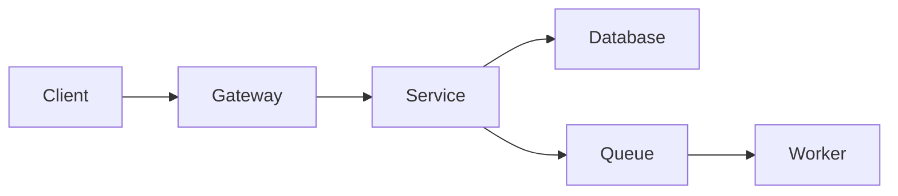

# 26. System Design

> Source range: questions 663–690
## 663. How would you design a URL shortener?

1. **Question**: How would you design a URL shortener?
2. **Difficulty**: Advanced
3. **Topic**: System Design
4. **What interviewer is testing**: Whether you can turn requirements into a scalable, reliable design and explain trade-offs quantitatively.
5. **Short interview answer (30–60 seconds)**: Use a short-code generator with a durable mapping store, collision-safe ID generation, cache, stateless redirect service, rate limits, and analytics separated from the redirect path.
6. **Detailed explanation**: Use a short-code generator with a durable mapping store, collision-safe ID generation, cache, stateless redirect service, rate limits, and analytics separated from the redirect path. State requirements, APIs, data ownership, consistency, failure handling, scaling, and observability.
7. **How it works internally**: Requests flow through edge, service, cache, queue, and storage components whose contracts and failure behavior determine system properties.
8. **Example**:

For “How would you design a URL shortener?”, the normal case follows the rule in the short answer; verify the relevant boundary case before using it in production.

9. **Code example**:




10. **Time & space complexity**: Estimate throughput, storage growth, latency, fan-out, hot keys, and per-request work with explicit assumptions.
11. **Real-world/project usage**: Apply the design to APIs, event workflows, data platforms, and operationally critical systems.
12. **Common mistakes**: Starting with technologies, ignoring requirements, missing idempotency, unbounded fan-out, no capacity model, or no recovery story.
13. **Advantages**: Clear boundaries, measured scalability, resilience, and evolvability when the design matches the domain.
14. **Limitations**: More components, operational cost, consistency trade-offs, and complex failure diagnosis.
15. **Comparison with related concepts**: Compare cache strategies, scaling methods, consistency models, replication/sharding, and synchronous/asynchronous flows.
16. **Production considerations**: Define SLOs, security, data lifecycle, cost, observability, load tests, disaster recovery, and migration plans.
17. **Possible follow-up questions**: What breaks at 10x traffic, during a partition, on duplicate requests, or when storage is unavailable?
18. **Senior-level follow-up questions**: How would you capacity-plan, evolve schemas, reduce blast radius, and prove recovery objectives?
19. **Scenario-based question**: Traffic or latency increases sharply. Explain how you would identify the bottleneck, protect the system, scale the right tier, and verify recovery.
20. **One-line revision note**: Use a short-code generator with a durable mapping store, collision-safe ID generation, cache, stateless redirect service, rate limits, and analytics separated from the redirect path.
21. **Image visuals (if required)**: An architecture, sequence, data-flow, or failure-mode diagram is strongly recommended.

---

## 664. How would you design an e-commerce backend?

1. **Question**: How would you design an e-commerce backend?
2. **Difficulty**: Advanced
3. **Topic**: System Design
4. **What interviewer is testing**: Whether you can turn requirements into a scalable, reliable design and explain trade-offs quantitatively.
5. **Short interview answer (30–60 seconds)**: Separate catalog, inventory, cart, order, payment, and fulfillment capabilities; use durable order state, idempotency, events, and clear consistency boundaries.
6. **Detailed explanation**: Separate catalog, inventory, cart, order, payment, and fulfillment capabilities; use durable order state, idempotency, events, and clear consistency boundaries. State requirements, APIs, data ownership, consistency, failure handling, scaling, and observability.
7. **How it works internally**: Requests flow through edge, service, cache, queue, and storage components whose contracts and failure behavior determine system properties.
8. **Example**:

For “How would you design an e-commerce backend?”, the normal case follows the rule in the short answer; verify the relevant boundary case before using it in production.

9. **Code example**:


10. **Time & space complexity**: Estimate throughput, storage growth, latency, fan-out, hot keys, and per-request work with explicit assumptions.
11. **Real-world/project usage**: Apply the design to APIs, event workflows, data platforms, and operationally critical systems.
12. **Common mistakes**: Starting with technologies, ignoring requirements, missing idempotency, unbounded fan-out, no capacity model, or no recovery story.
13. **Advantages**: Clear boundaries, measured scalability, resilience, and evolvability when the design matches the domain.
14. **Limitations**: More components, operational cost, consistency trade-offs, and complex failure diagnosis.
15. **Comparison with related concepts**: Compare cache strategies, scaling methods, consistency models, replication/sharding, and synchronous/asynchronous flows.
16. **Production considerations**: Define SLOs, security, data lifecycle, cost, observability, load tests, disaster recovery, and migration plans.
17. **Possible follow-up questions**: What breaks at 10x traffic, during a partition, on duplicate requests, or when storage is unavailable?
18. **Senior-level follow-up questions**: How would you capacity-plan, evolve schemas, reduce blast radius, and prove recovery objectives?
19. **Scenario-based question**: Traffic or latency increases sharply. Explain how you would identify the bottleneck, protect the system, scale the right tier, and verify recovery.
20. **One-line revision note**: Separate catalog, inventory, cart, order, payment, and fulfillment capabilities; use durable order state, idempotency, events, and clear consistency boundaries.
21. **Image visuals (if required)**: An architecture, sequence, data-flow, or failure-mode diagram is strongly recommended.

---

## 665. How would you design an order-management system?

1. **Question**: How would you design an order-management system?
2. **Difficulty**: Advanced
3. **Topic**: System Design
4. **What interviewer is testing**: Whether you can turn requirements into a scalable, reliable design and explain trade-offs quantitatively.
5. **Short interview answer (30–60 seconds)**: Model order state transitions explicitly, reserve inventory, authorize payment, publish events through an outbox, and reconcile failures with a saga.
6. **Detailed explanation**: Model order state transitions explicitly, reserve inventory, authorize payment, publish events through an outbox, and reconcile failures with a saga. State requirements, APIs, data ownership, consistency, failure handling, scaling, and observability.
7. **How it works internally**: Requests flow through edge, service, cache, queue, and storage components whose contracts and failure behavior determine system properties.
8. **Example**:

For “How would you design an order-management system?”, the normal case follows the rule in the short answer; verify the relevant boundary case before using it in production.

9. **Code example**:


10. **Time & space complexity**: Estimate throughput, storage growth, latency, fan-out, hot keys, and per-request work with explicit assumptions.
11. **Real-world/project usage**: Apply the design to APIs, event workflows, data platforms, and operationally critical systems.
12. **Common mistakes**: Starting with technologies, ignoring requirements, missing idempotency, unbounded fan-out, no capacity model, or no recovery story.
13. **Advantages**: Clear boundaries, measured scalability, resilience, and evolvability when the design matches the domain.
14. **Limitations**: More components, operational cost, consistency trade-offs, and complex failure diagnosis.
15. **Comparison with related concepts**: Compare cache strategies, scaling methods, consistency models, replication/sharding, and synchronous/asynchronous flows.
16. **Production considerations**: Define SLOs, security, data lifecycle, cost, observability, load tests, disaster recovery, and migration plans.
17. **Possible follow-up questions**: What breaks at 10x traffic, during a partition, on duplicate requests, or when storage is unavailable?
18. **Senior-level follow-up questions**: How would you capacity-plan, evolve schemas, reduce blast radius, and prove recovery objectives?
19. **Scenario-based question**: Traffic or latency increases sharply. Explain how you would identify the bottleneck, protect the system, scale the right tier, and verify recovery.
20. **One-line revision note**: Model order state transitions explicitly, reserve inventory, authorize payment, publish events through an outbox, and reconcile failures with a saga.
21. **Image visuals (if required)**: An architecture, sequence, data-flow, or failure-mode diagram is strongly recommended.

---

## 666. How would you design a payment system?

1. **Question**: How would you design a payment system?
2. **Difficulty**: Advanced
3. **Topic**: System Design
4. **What interviewer is testing**: Whether you can turn requirements into a scalable, reliable design and explain trade-offs quantitatively.
5. **Short interview answer (30–60 seconds)**: Use an idempotency key, payment state machine, durable ledger, provider abstraction, retries with limits, reconciliation, and strong auditability.
6. **Detailed explanation**: Use an idempotency key, payment state machine, durable ledger, provider abstraction, retries with limits, reconciliation, and strong auditability. State requirements, APIs, data ownership, consistency, failure handling, scaling, and observability.
7. **How it works internally**: Requests flow through edge, service, cache, queue, and storage components whose contracts and failure behavior determine system properties.
8. **Example**:

For “How would you design a payment system?”, the normal case follows the rule in the short answer; verify the relevant boundary case before using it in production.

9. **Code example**:


10. **Time & space complexity**: Estimate throughput, storage growth, latency, fan-out, hot keys, and per-request work with explicit assumptions.
11. **Real-world/project usage**: Apply the design to APIs, event workflows, data platforms, and operationally critical systems.
12. **Common mistakes**: Starting with technologies, ignoring requirements, missing idempotency, unbounded fan-out, no capacity model, or no recovery story.
13. **Advantages**: Clear boundaries, measured scalability, resilience, and evolvability when the design matches the domain.
14. **Limitations**: More components, operational cost, consistency trade-offs, and complex failure diagnosis.
15. **Comparison with related concepts**: Compare cache strategies, scaling methods, consistency models, replication/sharding, and synchronous/asynchronous flows.
16. **Production considerations**: Define SLOs, security, data lifecycle, cost, observability, load tests, disaster recovery, and migration plans.
17. **Possible follow-up questions**: What breaks at 10x traffic, during a partition, on duplicate requests, or when storage is unavailable?
18. **Senior-level follow-up questions**: How would you capacity-plan, evolve schemas, reduce blast radius, and prove recovery objectives?
19. **Scenario-based question**: Traffic or latency increases sharply. Explain how you would identify the bottleneck, protect the system, scale the right tier, and verify recovery.
20. **One-line revision note**: Use an idempotency key, payment state machine, durable ledger, provider abstraction, retries with limits, reconciliation, and strong auditability.
21. **Image visuals (if required)**: An architecture, sequence, data-flow, or failure-mode diagram is strongly recommended.

---

## 667. How would you design a notification service?

1. **Question**: How would you design a notification service?
2. **Difficulty**: Advanced
3. **Topic**: System Design
4. **What interviewer is testing**: Whether you can turn requirements into a scalable, reliable design and explain trade-offs quantitatively.
5. **Short interview answer (30–60 seconds)**: Accept notification requests asynchronously, route by channel and preference, use queues, provider adapters, retries, deduplication, and delivery status.
6. **Detailed explanation**: Accept notification requests asynchronously, route by channel and preference, use queues, provider adapters, retries, deduplication, and delivery status. State requirements, APIs, data ownership, consistency, failure handling, scaling, and observability.
7. **How it works internally**: Requests flow through edge, service, cache, queue, and storage components whose contracts and failure behavior determine system properties.
8. **Example**:

For “How would you design a notification service?”, the normal case follows the rule in the short answer; verify the relevant boundary case before using it in production.

9. **Code example**:


10. **Time & space complexity**: Estimate throughput, storage growth, latency, fan-out, hot keys, and per-request work with explicit assumptions.
11. **Real-world/project usage**: Apply the design to APIs, event workflows, data platforms, and operationally critical systems.
12. **Common mistakes**: Starting with technologies, ignoring requirements, missing idempotency, unbounded fan-out, no capacity model, or no recovery story.
13. **Advantages**: Clear boundaries, measured scalability, resilience, and evolvability when the design matches the domain.
14. **Limitations**: More components, operational cost, consistency trade-offs, and complex failure diagnosis.
15. **Comparison with related concepts**: Compare cache strategies, scaling methods, consistency models, replication/sharding, and synchronous/asynchronous flows.
16. **Production considerations**: Define SLOs, security, data lifecycle, cost, observability, load tests, disaster recovery, and migration plans.
17. **Possible follow-up questions**: What breaks at 10x traffic, during a partition, on duplicate requests, or when storage is unavailable?
18. **Senior-level follow-up questions**: How would you capacity-plan, evolve schemas, reduce blast radius, and prove recovery objectives?
19. **Scenario-based question**: Traffic or latency increases sharply. Explain how you would identify the bottleneck, protect the system, scale the right tier, and verify recovery.
20. **One-line revision note**: Accept notification requests asynchronously, route by channel and preference, use queues, provider adapters, retries, deduplication, and delivery status.
21. **Image visuals (if required)**: An architecture, sequence, data-flow, or failure-mode diagram is strongly recommended.

---

## 668. How would you design a file-upload service?

1. **Question**: How would you design a file-upload service?
2. **Difficulty**: Advanced
3. **Topic**: System Design
4. **What interviewer is testing**: Whether you can turn requirements into a scalable, reliable design and explain trade-offs quantitatively.
5. **Short interview answer (30–60 seconds)**: Upload directly to object storage using signed URLs, validate metadata and content, process asynchronously, store status, and serve authorized downloads.
6. **Detailed explanation**: Upload directly to object storage using signed URLs, validate metadata and content, process asynchronously, store status, and serve authorized downloads. State requirements, APIs, data ownership, consistency, failure handling, scaling, and observability.
7. **How it works internally**: Requests flow through edge, service, cache, queue, and storage components whose contracts and failure behavior determine system properties.
8. **Example**:

For “How would you design a file-upload service?”, the normal case follows the rule in the short answer; verify the relevant boundary case before using it in production.

9. **Code example**:


10. **Time & space complexity**: Estimate throughput, storage growth, latency, fan-out, hot keys, and per-request work with explicit assumptions.
11. **Real-world/project usage**: Apply the design to APIs, event workflows, data platforms, and operationally critical systems.
12. **Common mistakes**: Starting with technologies, ignoring requirements, missing idempotency, unbounded fan-out, no capacity model, or no recovery story.
13. **Advantages**: Clear boundaries, measured scalability, resilience, and evolvability when the design matches the domain.
14. **Limitations**: More components, operational cost, consistency trade-offs, and complex failure diagnosis.
15. **Comparison with related concepts**: Compare cache strategies, scaling methods, consistency models, replication/sharding, and synchronous/asynchronous flows.
16. **Production considerations**: Define SLOs, security, data lifecycle, cost, observability, load tests, disaster recovery, and migration plans.
17. **Possible follow-up questions**: What breaks at 10x traffic, during a partition, on duplicate requests, or when storage is unavailable?
18. **Senior-level follow-up questions**: How would you capacity-plan, evolve schemas, reduce blast radius, and prove recovery objectives?
19. **Scenario-based question**: Traffic or latency increases sharply. Explain how you would identify the bottleneck, protect the system, scale the right tier, and verify recovery.
20. **One-line revision note**: Upload directly to object storage using signed URLs, validate metadata and content, process asynchronously, store status, and serve authorized downloads.
21. **Image visuals (if required)**: An architecture, sequence, data-flow, or failure-mode diagram is strongly recommended.

---

## 669. How would you design an authentication service?

1. **Question**: How would you design an authentication service?
2. **Difficulty**: Advanced
3. **Topic**: System Design
4. **What interviewer is testing**: Whether you can turn requirements into a scalable, reliable design and explain trade-offs quantitatively.
5. **Short interview answer (30–60 seconds)**: Separate identity, credential, token, authorization, and audit concerns; use secure hashing, key rotation, rate limits, and short-lived access tokens.
6. **Detailed explanation**: Separate identity, credential, token, authorization, and audit concerns; use secure hashing, key rotation, rate limits, and short-lived access tokens. State requirements, APIs, data ownership, consistency, failure handling, scaling, and observability.
7. **How it works internally**: Requests flow through edge, service, cache, queue, and storage components whose contracts and failure behavior determine system properties.
8. **Example**:

For “How would you design an authentication service?”, the normal case follows the rule in the short answer; verify the relevant boundary case before using it in production.

9. **Code example**:


10. **Time & space complexity**: Estimate throughput, storage growth, latency, fan-out, hot keys, and per-request work with explicit assumptions.
11. **Real-world/project usage**: Apply the design to APIs, event workflows, data platforms, and operationally critical systems.
12. **Common mistakes**: Starting with technologies, ignoring requirements, missing idempotency, unbounded fan-out, no capacity model, or no recovery story.
13. **Advantages**: Clear boundaries, measured scalability, resilience, and evolvability when the design matches the domain.
14. **Limitations**: More components, operational cost, consistency trade-offs, and complex failure diagnosis.
15. **Comparison with related concepts**: Compare cache strategies, scaling methods, consistency models, replication/sharding, and synchronous/asynchronous flows.
16. **Production considerations**: Define SLOs, security, data lifecycle, cost, observability, load tests, disaster recovery, and migration plans.
17. **Possible follow-up questions**: What breaks at 10x traffic, during a partition, on duplicate requests, or when storage is unavailable?
18. **Senior-level follow-up questions**: How would you capacity-plan, evolve schemas, reduce blast radius, and prove recovery objectives?
19. **Scenario-based question**: Traffic or latency increases sharply. Explain how you would identify the bottleneck, protect the system, scale the right tier, and verify recovery.
20. **One-line revision note**: Separate identity, credential, token, authorization, and audit concerns; use secure hashing, key rotation, rate limits, and short-lived access tokens.
21. **Image visuals (if required)**: An architecture, sequence, data-flow, or failure-mode diagram is strongly recommended.

---

## 670. How would you design a chat application?

1. **Question**: How would you design a chat application?
2. **Difficulty**: Advanced
3. **Topic**: System Design
4. **What interviewer is testing**: Whether you can turn requirements into a scalable, reliable design and explain trade-offs quantitatively.
5. **Short interview answer (30–60 seconds)**: Use persistent connections for presence and messages, partition conversations, durable message storage, fan-out, offline delivery, and moderation controls.
6. **Detailed explanation**: Use persistent connections for presence and messages, partition conversations, durable message storage, fan-out, offline delivery, and moderation controls. State requirements, APIs, data ownership, consistency, failure handling, scaling, and observability.
7. **How it works internally**: Requests flow through edge, service, cache, queue, and storage components whose contracts and failure behavior determine system properties.
8. **Example**:

For “How would you design a chat application?”, the normal case follows the rule in the short answer; verify the relevant boundary case before using it in production.

9. **Code example**:


10. **Time & space complexity**: Estimate throughput, storage growth, latency, fan-out, hot keys, and per-request work with explicit assumptions.
11. **Real-world/project usage**: Apply the design to APIs, event workflows, data platforms, and operationally critical systems.
12. **Common mistakes**: Starting with technologies, ignoring requirements, missing idempotency, unbounded fan-out, no capacity model, or no recovery story.
13. **Advantages**: Clear boundaries, measured scalability, resilience, and evolvability when the design matches the domain.
14. **Limitations**: More components, operational cost, consistency trade-offs, and complex failure diagnosis.
15. **Comparison with related concepts**: Compare cache strategies, scaling methods, consistency models, replication/sharding, and synchronous/asynchronous flows.
16. **Production considerations**: Define SLOs, security, data lifecycle, cost, observability, load tests, disaster recovery, and migration plans.
17. **Possible follow-up questions**: What breaks at 10x traffic, during a partition, on duplicate requests, or when storage is unavailable?
18. **Senior-level follow-up questions**: How would you capacity-plan, evolve schemas, reduce blast radius, and prove recovery objectives?
19. **Scenario-based question**: Traffic or latency increases sharply. Explain how you would identify the bottleneck, protect the system, scale the right tier, and verify recovery.
20. **One-line revision note**: Use persistent connections for presence and messages, partition conversations, durable message storage, fan-out, offline delivery, and moderation controls.
21. **Image visuals (if required)**: An architecture, sequence, data-flow, or failure-mode diagram is strongly recommended.

---

## 671. How would you design a booking system?

1. **Question**: How would you design a booking system?
2. **Difficulty**: Advanced
3. **Topic**: System Design
4. **What interviewer is testing**: Whether you can turn requirements into a scalable, reliable design and explain trade-offs quantitatively.
5. **Short interview answer (30–60 seconds)**: Use inventory/slot holds with expiry, conflict-safe booking, payment state, idempotency, and a clear cancellation/compensation policy.
6. **Detailed explanation**: Use inventory/slot holds with expiry, conflict-safe booking, payment state, idempotency, and a clear cancellation/compensation policy. State requirements, APIs, data ownership, consistency, failure handling, scaling, and observability.
7. **How it works internally**: Requests flow through edge, service, cache, queue, and storage components whose contracts and failure behavior determine system properties.
8. **Example**:

For “How would you design a booking system?”, the normal case follows the rule in the short answer; verify the relevant boundary case before using it in production.

9. **Code example**:


10. **Time & space complexity**: Estimate throughput, storage growth, latency, fan-out, hot keys, and per-request work with explicit assumptions.
11. **Real-world/project usage**: Apply the design to APIs, event workflows, data platforms, and operationally critical systems.
12. **Common mistakes**: Starting with technologies, ignoring requirements, missing idempotency, unbounded fan-out, no capacity model, or no recovery story.
13. **Advantages**: Clear boundaries, measured scalability, resilience, and evolvability when the design matches the domain.
14. **Limitations**: More components, operational cost, consistency trade-offs, and complex failure diagnosis.
15. **Comparison with related concepts**: Compare cache strategies, scaling methods, consistency models, replication/sharding, and synchronous/asynchronous flows.
16. **Production considerations**: Define SLOs, security, data lifecycle, cost, observability, load tests, disaster recovery, and migration plans.
17. **Possible follow-up questions**: What breaks at 10x traffic, during a partition, on duplicate requests, or when storage is unavailable?
18. **Senior-level follow-up questions**: How would you capacity-plan, evolve schemas, reduce blast radius, and prove recovery objectives?
19. **Scenario-based question**: Traffic or latency increases sharply. Explain how you would identify the bottleneck, protect the system, scale the right tier, and verify recovery.
20. **One-line revision note**: Use inventory/slot holds with expiry, conflict-safe booking, payment state, idempotency, and a clear cancellation/compensation policy.
21. **Image visuals (if required)**: An architecture, sequence, data-flow, or failure-mode diagram is strongly recommended.

---

## 672. How would you design an employee/HRMS platform?

1. **Question**: How would you design an employee/HRMS platform?
2. **Difficulty**: Advanced
3. **Topic**: System Design
4. **What interviewer is testing**: Whether you can turn requirements into a scalable, reliable design and explain trade-offs quantitatively.
5. **Short interview answer (30–60 seconds)**: Separate employee, identity, workflow, reporting, and document capabilities with authorization, audit, retention, and integration boundaries.
6. **Detailed explanation**: Separate employee, identity, workflow, reporting, and document capabilities with authorization, audit, retention, and integration boundaries. State requirements, APIs, data ownership, consistency, failure handling, scaling, and observability.
7. **How it works internally**: Requests flow through edge, service, cache, queue, and storage components whose contracts and failure behavior determine system properties.
8. **Example**:

For “How would you design an employee/HRMS platform?”, the normal case follows the rule in the short answer; verify the relevant boundary case before using it in production.

9. **Code example**:


10. **Time & space complexity**: Estimate throughput, storage growth, latency, fan-out, hot keys, and per-request work with explicit assumptions.
11. **Real-world/project usage**: Apply the design to APIs, event workflows, data platforms, and operationally critical systems.
12. **Common mistakes**: Starting with technologies, ignoring requirements, missing idempotency, unbounded fan-out, no capacity model, or no recovery story.
13. **Advantages**: Clear boundaries, measured scalability, resilience, and evolvability when the design matches the domain.
14. **Limitations**: More components, operational cost, consistency trade-offs, and complex failure diagnosis.
15. **Comparison with related concepts**: Compare cache strategies, scaling methods, consistency models, replication/sharding, and synchronous/asynchronous flows.
16. **Production considerations**: Define SLOs, security, data lifecycle, cost, observability, load tests, disaster recovery, and migration plans.
17. **Possible follow-up questions**: What breaks at 10x traffic, during a partition, on duplicate requests, or when storage is unavailable?
18. **Senior-level follow-up questions**: How would you capacity-plan, evolve schemas, reduce blast radius, and prove recovery objectives?
19. **Scenario-based question**: Traffic or latency increases sharply. Explain how you would identify the bottleneck, protect the system, scale the right tier, and verify recovery.
20. **One-line revision note**: Separate employee, identity, workflow, reporting, and document capabilities with authorization, audit, retention, and integration boundaries.
21. **Image visuals (if required)**: An architecture, sequence, data-flow, or failure-mode diagram is strongly recommended.

---

## 673. How would you design a high-traffic REST API?

1. **Question**: How would you design a high-traffic REST API?
2. **Difficulty**: Advanced
3. **Topic**: System Design
4. **What interviewer is testing**: Whether you can turn requirements into a scalable, reliable design and explain trade-offs quantitatively.
5. **Short interview answer (30–60 seconds)**: Use stateless services behind a load balancer, cache, queues, read replicas, rate limits, pagination, observability, and horizontal scaling.
6. **Detailed explanation**: Use stateless services behind a load balancer, cache, queues, read replicas, rate limits, pagination, observability, and horizontal scaling. State requirements, APIs, data ownership, consistency, failure handling, scaling, and observability.
7. **How it works internally**: Requests flow through edge, service, cache, queue, and storage components whose contracts and failure behavior determine system properties.
8. **Example**:

For “How would you design a high-traffic REST API?”, the normal case follows the rule in the short answer; verify the relevant boundary case before using it in production.

9. **Code example**:


10. **Time & space complexity**: Estimate throughput, storage growth, latency, fan-out, hot keys, and per-request work with explicit assumptions.
11. **Real-world/project usage**: Apply the design to APIs, event workflows, data platforms, and operationally critical systems.
12. **Common mistakes**: Starting with technologies, ignoring requirements, missing idempotency, unbounded fan-out, no capacity model, or no recovery story.
13. **Advantages**: Clear boundaries, measured scalability, resilience, and evolvability when the design matches the domain.
14. **Limitations**: More components, operational cost, consistency trade-offs, and complex failure diagnosis.
15. **Comparison with related concepts**: Compare cache strategies, scaling methods, consistency models, replication/sharding, and synchronous/asynchronous flows.
16. **Production considerations**: Define SLOs, security, data lifecycle, cost, observability, load tests, disaster recovery, and migration plans.
17. **Possible follow-up questions**: What breaks at 10x traffic, during a partition, on duplicate requests, or when storage is unavailable?
18. **Senior-level follow-up questions**: How would you capacity-plan, evolve schemas, reduce blast radius, and prove recovery objectives?
19. **Scenario-based question**: Traffic or latency increases sharply. Explain how you would identify the bottleneck, protect the system, scale the right tier, and verify recovery.
20. **One-line revision note**: Use stateless services behind a load balancer, cache, queues, read replicas, rate limits, pagination, observability, and horizontal scaling.
21. **Image visuals (if required)**: An architecture, sequence, data-flow, or failure-mode diagram is strongly recommended.

---

## 674. How would you scale from 1,000 to 1 million users?

1. **Question**: How would you scale from 1,000 to 1 million users?
2. **Difficulty**: Advanced
3. **Topic**: System Design
4. **What interviewer is testing**: Whether you can turn requirements into a scalable, reliable design and explain trade-offs quantitatively.
5. **Short interview answer (30–60 seconds)**: Measure workload, remove bottlenecks iteratively, add caching and replicas, partition hot data, scale stateless tiers horizontally, and protect dependencies.
6. **Detailed explanation**: Measure workload, remove bottlenecks iteratively, add caching and replicas, partition hot data, scale stateless tiers horizontally, and protect dependencies. State requirements, APIs, data ownership, consistency, failure handling, scaling, and observability.
7. **How it works internally**: Requests flow through edge, service, cache, queue, and storage components whose contracts and failure behavior determine system properties.
8. **Example**:

For “How would you scale from 1,000 to 1 million users?”, the normal case follows the rule in the short answer; verify the relevant boundary case before using it in production.

9. **Code example**:


10. **Time & space complexity**: Estimate throughput, storage growth, latency, fan-out, hot keys, and per-request work with explicit assumptions.
11. **Real-world/project usage**: Apply the design to APIs, event workflows, data platforms, and operationally critical systems.
12. **Common mistakes**: Starting with technologies, ignoring requirements, missing idempotency, unbounded fan-out, no capacity model, or no recovery story.
13. **Advantages**: Clear boundaries, measured scalability, resilience, and evolvability when the design matches the domain.
14. **Limitations**: More components, operational cost, consistency trade-offs, and complex failure diagnosis.
15. **Comparison with related concepts**: Compare cache strategies, scaling methods, consistency models, replication/sharding, and synchronous/asynchronous flows.
16. **Production considerations**: Define SLOs, security, data lifecycle, cost, observability, load tests, disaster recovery, and migration plans.
17. **Possible follow-up questions**: What breaks at 10x traffic, during a partition, on duplicate requests, or when storage is unavailable?
18. **Senior-level follow-up questions**: How would you capacity-plan, evolve schemas, reduce blast radius, and prove recovery objectives?
19. **Scenario-based question**: Traffic or latency increases sharply. Explain how you would identify the bottleneck, protect the system, scale the right tier, and verify recovery.
20. **One-line revision note**: Measure workload, remove bottlenecks iteratively, add caching and replicas, partition hot data, scale stateless tiers horizontally, and protect dependencies.
21. **Image visuals (if required)**: An architecture, sequence, data-flow, or failure-mode diagram is strongly recommended.

---

## 675. Vertical vs horizontal scaling?

1. **Question**: Vertical vs horizontal scaling?
2. **Difficulty**: Advanced
3. **Topic**: System Design
4. **What interviewer is testing**: Whether you can turn requirements into a scalable, reliable design and explain trade-offs quantitatively.
5. **Short interview answer (30–60 seconds)**: Vertical scaling increases capacity of one machine; horizontal scaling adds machines and usually improves resilience but requires distributed design.
6. **Detailed explanation**: Vertical scaling increases capacity of one machine; horizontal scaling adds machines and usually improves resilience but requires distributed design. State requirements, APIs, data ownership, consistency, failure handling, scaling, and observability.
7. **How it works internally**: Requests flow through edge, service, cache, queue, and storage components whose contracts and failure behavior determine system properties.
8. **Example**:

For “Vertical vs horizontal scaling?”, the normal case follows the rule in the short answer; verify the relevant boundary case before using it in production.

9. **Code example**:


10. **Time & space complexity**: Estimate throughput, storage growth, latency, fan-out, hot keys, and per-request work with explicit assumptions.
11. **Real-world/project usage**: Apply the design to APIs, event workflows, data platforms, and operationally critical systems.
12. **Common mistakes**: Starting with technologies, ignoring requirements, missing idempotency, unbounded fan-out, no capacity model, or no recovery story.
13. **Advantages**: Clear boundaries, measured scalability, resilience, and evolvability when the design matches the domain.
14. **Limitations**: More components, operational cost, consistency trade-offs, and complex failure diagnosis.
15. **Comparison with related concepts**: Compare cache strategies, scaling methods, consistency models, replication/sharding, and synchronous/asynchronous flows.
16. **Production considerations**: Define SLOs, security, data lifecycle, cost, observability, load tests, disaster recovery, and migration plans.
17. **Possible follow-up questions**: What breaks at 10x traffic, during a partition, on duplicate requests, or when storage is unavailable?
18. **Senior-level follow-up questions**: How would you capacity-plan, evolve schemas, reduce blast radius, and prove recovery objectives?
19. **Scenario-based question**: Traffic or latency increases sharply. Explain how you would identify the bottleneck, protect the system, scale the right tier, and verify recovery.
20. **One-line revision note**: Vertical scaling increases capacity of one machine; horizontal scaling adds machines and usually improves resilience but requires distributed design.
21. **Image visuals (if required)**: An architecture, sequence, data-flow, or failure-mode diagram is strongly recommended.

---

## 676. What is load balancing?

1. **Question**: What is load balancing?
2. **Difficulty**: Advanced
3. **Topic**: System Design
4. **What interviewer is testing**: Whether you can turn requirements into a scalable, reliable design and explain trade-offs quantitatively.
5. **Short interview answer (30–60 seconds)**: Load balancing distributes traffic across healthy instances using algorithms and health checks, improving utilization and availability.
6. **Detailed explanation**: Load balancing distributes traffic across healthy instances using algorithms and health checks, improving utilization and availability. State requirements, APIs, data ownership, consistency, failure handling, scaling, and observability.
7. **How it works internally**: Requests flow through edge, service, cache, queue, and storage components whose contracts and failure behavior determine system properties.
8. **Example**:

For “What is load balancing?”, the normal case follows the rule in the short answer; verify the relevant boundary case before using it in production.

9. **Code example**:


10. **Time & space complexity**: Estimate throughput, storage growth, latency, fan-out, hot keys, and per-request work with explicit assumptions.
11. **Real-world/project usage**: Apply the design to APIs, event workflows, data platforms, and operationally critical systems.
12. **Common mistakes**: Starting with technologies, ignoring requirements, missing idempotency, unbounded fan-out, no capacity model, or no recovery story.
13. **Advantages**: Clear boundaries, measured scalability, resilience, and evolvability when the design matches the domain.
14. **Limitations**: More components, operational cost, consistency trade-offs, and complex failure diagnosis.
15. **Comparison with related concepts**: Compare cache strategies, scaling methods, consistency models, replication/sharding, and synchronous/asynchronous flows.
16. **Production considerations**: Define SLOs, security, data lifecycle, cost, observability, load tests, disaster recovery, and migration plans.
17. **Possible follow-up questions**: What breaks at 10x traffic, during a partition, on duplicate requests, or when storage is unavailable?
18. **Senior-level follow-up questions**: How would you capacity-plan, evolve schemas, reduce blast radius, and prove recovery objectives?
19. **Scenario-based question**: Traffic or latency increases sharply. Explain how you would identify the bottleneck, protect the system, scale the right tier, and verify recovery.
20. **One-line revision note**: Load balancing distributes traffic across healthy instances using algorithms and health checks, improving utilization and availability.
21. **Image visuals (if required)**: An architecture, sequence, data-flow, or failure-mode diagram is strongly recommended.

---

## 677. What is caching?

1. **Question**: What is caching?
2. **Difficulty**: Advanced
3. **Topic**: System Design
4. **What interviewer is testing**: Whether you can turn requirements into a scalable, reliable design and explain trade-offs quantitatively.
5. **Short interview answer (30–60 seconds)**: Caching stores reusable results closer to consumers to reduce latency and backend load, with explicit freshness and invalidation rules.
6. **Detailed explanation**: Caching stores reusable results closer to consumers to reduce latency and backend load, with explicit freshness and invalidation rules. State requirements, APIs, data ownership, consistency, failure handling, scaling, and observability.
7. **How it works internally**: Requests flow through edge, service, cache, queue, and storage components whose contracts and failure behavior determine system properties.
8. **Example**:

For “What is caching?”, the normal case follows the rule in the short answer; verify the relevant boundary case before using it in production.

9. **Code example**:


10. **Time & space complexity**: Estimate throughput, storage growth, latency, fan-out, hot keys, and per-request work with explicit assumptions.
11. **Real-world/project usage**: Apply the design to APIs, event workflows, data platforms, and operationally critical systems.
12. **Common mistakes**: Starting with technologies, ignoring requirements, missing idempotency, unbounded fan-out, no capacity model, or no recovery story.
13. **Advantages**: Clear boundaries, measured scalability, resilience, and evolvability when the design matches the domain.
14. **Limitations**: More components, operational cost, consistency trade-offs, and complex failure diagnosis.
15. **Comparison with related concepts**: Compare cache strategies, scaling methods, consistency models, replication/sharding, and synchronous/asynchronous flows.
16. **Production considerations**: Define SLOs, security, data lifecycle, cost, observability, load tests, disaster recovery, and migration plans.
17. **Possible follow-up questions**: What breaks at 10x traffic, during a partition, on duplicate requests, or when storage is unavailable?
18. **Senior-level follow-up questions**: How would you capacity-plan, evolve schemas, reduce blast radius, and prove recovery objectives?
19. **Scenario-based question**: Traffic or latency increases sharply. Explain how you would identify the bottleneck, protect the system, scale the right tier, and verify recovery.
20. **One-line revision note**: Caching stores reusable results closer to consumers to reduce latency and backend load, with explicit freshness and invalidation rules.
21. **Image visuals (if required)**: An architecture, sequence, data-flow, or failure-mode diagram is strongly recommended.

---

## 678. Cache-aside vs write-through vs write-behind?

1. **Question**: Cache-aside vs write-through vs write-behind?
2. **Difficulty**: Advanced
3. **Topic**: System Design
4. **What interviewer is testing**: Whether you can turn requirements into a scalable, reliable design and explain trade-offs quantitatively.
5. **Short interview answer (30–60 seconds)**: Cache-aside loads on miss and writes the cache explicitly; write-through writes cache and store together; write-behind delays persistence and risks loss.
6. **Detailed explanation**: Cache-aside loads on miss and writes the cache explicitly; write-through writes cache and store together; write-behind delays persistence and risks loss. State requirements, APIs, data ownership, consistency, failure handling, scaling, and observability.
7. **How it works internally**: Requests flow through edge, service, cache, queue, and storage components whose contracts and failure behavior determine system properties.
8. **Example**:

For “Cache-aside vs write-through vs write-behind?”, the normal case follows the rule in the short answer; verify the relevant boundary case before using it in production.

9. **Code example**:


10. **Time & space complexity**: Estimate throughput, storage growth, latency, fan-out, hot keys, and per-request work with explicit assumptions.
11. **Real-world/project usage**: Apply the design to APIs, event workflows, data platforms, and operationally critical systems.
12. **Common mistakes**: Starting with technologies, ignoring requirements, missing idempotency, unbounded fan-out, no capacity model, or no recovery story.
13. **Advantages**: Clear boundaries, measured scalability, resilience, and evolvability when the design matches the domain.
14. **Limitations**: More components, operational cost, consistency trade-offs, and complex failure diagnosis.
15. **Comparison with related concepts**: Compare cache strategies, scaling methods, consistency models, replication/sharding, and synchronous/asynchronous flows.
16. **Production considerations**: Define SLOs, security, data lifecycle, cost, observability, load tests, disaster recovery, and migration plans.
17. **Possible follow-up questions**: What breaks at 10x traffic, during a partition, on duplicate requests, or when storage is unavailable?
18. **Senior-level follow-up questions**: How would you capacity-plan, evolve schemas, reduce blast radius, and prove recovery objectives?
19. **Scenario-based question**: Traffic or latency increases sharply. Explain how you would identify the bottleneck, protect the system, scale the right tier, and verify recovery.
20. **One-line revision note**: Cache-aside loads on miss and writes the cache explicitly; write-through writes cache and store together; write-behind delays persistence and risks loss.
21. **Image visuals (if required)**: An architecture, sequence, data-flow, or failure-mode diagram is strongly recommended.

---

## 679. How do you handle cache invalidation?

1. **Question**: How do you handle cache invalidation?
2. **Difficulty**: Advanced
3. **Topic**: System Design
4. **What interviewer is testing**: Whether you can turn requirements into a scalable, reliable design and explain trade-offs quantitatively.
5. **Short interview answer (30–60 seconds)**: Use TTLs, versioned keys, explicit invalidation events, write-through policies, and accept bounded staleness where the domain allows it.
6. **Detailed explanation**: Use TTLs, versioned keys, explicit invalidation events, write-through policies, and accept bounded staleness where the domain allows it. State requirements, APIs, data ownership, consistency, failure handling, scaling, and observability.
7. **How it works internally**: Requests flow through edge, service, cache, queue, and storage components whose contracts and failure behavior determine system properties.
8. **Example**:

For “How do you handle cache invalidation?”, the normal case follows the rule in the short answer; verify the relevant boundary case before using it in production.

9. **Code example**:


10. **Time & space complexity**: Estimate throughput, storage growth, latency, fan-out, hot keys, and per-request work with explicit assumptions.
11. **Real-world/project usage**: Apply the design to APIs, event workflows, data platforms, and operationally critical systems.
12. **Common mistakes**: Starting with technologies, ignoring requirements, missing idempotency, unbounded fan-out, no capacity model, or no recovery story.
13. **Advantages**: Clear boundaries, measured scalability, resilience, and evolvability when the design matches the domain.
14. **Limitations**: More components, operational cost, consistency trade-offs, and complex failure diagnosis.
15. **Comparison with related concepts**: Compare cache strategies, scaling methods, consistency models, replication/sharding, and synchronous/asynchronous flows.
16. **Production considerations**: Define SLOs, security, data lifecycle, cost, observability, load tests, disaster recovery, and migration plans.
17. **Possible follow-up questions**: What breaks at 10x traffic, during a partition, on duplicate requests, or when storage is unavailable?
18. **Senior-level follow-up questions**: How would you capacity-plan, evolve schemas, reduce blast radius, and prove recovery objectives?
19. **Scenario-based question**: Traffic or latency increases sharply. Explain how you would identify the bottleneck, protect the system, scale the right tier, and verify recovery.
20. **One-line revision note**: Use TTLs, versioned keys, explicit invalidation events, write-through policies, and accept bounded staleness where the domain allows it.
21. **Image visuals (if required)**: An architecture, sequence, data-flow, or failure-mode diagram is strongly recommended.

---

## 680. Redis vs database caching?

1. **Question**: Redis vs database caching?
2. **Difficulty**: Advanced
3. **Topic**: System Design
4. **What interviewer is testing**: Whether you can turn requirements into a scalable, reliable design and explain trade-offs quantitatively.
5. **Short interview answer (30–60 seconds)**: Redis offers fast shared data structures and distributed caching; database caching is simpler but competes with transactional storage resources.
6. **Detailed explanation**: Redis offers fast shared data structures and distributed caching; database caching is simpler but competes with transactional storage resources. State requirements, APIs, data ownership, consistency, failure handling, scaling, and observability.
7. **How it works internally**: Requests flow through edge, service, cache, queue, and storage components whose contracts and failure behavior determine system properties.
8. **Example**:

For “Redis vs database caching?”, the normal case follows the rule in the short answer; verify the relevant boundary case before using it in production.

9. **Code example**:


10. **Time & space complexity**: Estimate throughput, storage growth, latency, fan-out, hot keys, and per-request work with explicit assumptions.
11. **Real-world/project usage**: Apply the design to APIs, event workflows, data platforms, and operationally critical systems.
12. **Common mistakes**: Starting with technologies, ignoring requirements, missing idempotency, unbounded fan-out, no capacity model, or no recovery story.
13. **Advantages**: Clear boundaries, measured scalability, resilience, and evolvability when the design matches the domain.
14. **Limitations**: More components, operational cost, consistency trade-offs, and complex failure diagnosis.
15. **Comparison with related concepts**: Compare cache strategies, scaling methods, consistency models, replication/sharding, and synchronous/asynchronous flows.
16. **Production considerations**: Define SLOs, security, data lifecycle, cost, observability, load tests, disaster recovery, and migration plans.
17. **Possible follow-up questions**: What breaks at 10x traffic, during a partition, on duplicate requests, or when storage is unavailable?
18. **Senior-level follow-up questions**: How would you capacity-plan, evolve schemas, reduce blast radius, and prove recovery objectives?
19. **Scenario-based question**: Traffic or latency increases sharply. Explain how you would identify the bottleneck, protect the system, scale the right tier, and verify recovery.
20. **One-line revision note**: Redis offers fast shared data structures and distributed caching; database caching is simpler but competes with transactional storage resources.
21. **Image visuals (if required)**: An architecture, sequence, data-flow, or failure-mode diagram is strongly recommended.

---

## 681. What is database sharding?

1. **Question**: What is database sharding?
2. **Difficulty**: Advanced
3. **Topic**: System Design
4. **What interviewer is testing**: Whether you can turn requirements into a scalable, reliable design and explain trade-offs quantitatively.
5. **Short interview answer (30–60 seconds)**: Sharding distributes rows across independent database partitions or nodes using a shard key to scale capacity and write throughput.
6. **Detailed explanation**: Sharding distributes rows across independent database partitions or nodes using a shard key to scale capacity and write throughput. State requirements, APIs, data ownership, consistency, failure handling, scaling, and observability.
7. **How it works internally**: Requests flow through edge, service, cache, queue, and storage components whose contracts and failure behavior determine system properties.
8. **Example**:

For “What is database sharding?”, the normal case follows the rule in the short answer; verify the relevant boundary case before using it in production.

9. **Code example**:


10. **Time & space complexity**: Estimate throughput, storage growth, latency, fan-out, hot keys, and per-request work with explicit assumptions.
11. **Real-world/project usage**: Apply the design to APIs, event workflows, data platforms, and operationally critical systems.
12. **Common mistakes**: Starting with technologies, ignoring requirements, missing idempotency, unbounded fan-out, no capacity model, or no recovery story.
13. **Advantages**: Clear boundaries, measured scalability, resilience, and evolvability when the design matches the domain.
14. **Limitations**: More components, operational cost, consistency trade-offs, and complex failure diagnosis.
15. **Comparison with related concepts**: Compare cache strategies, scaling methods, consistency models, replication/sharding, and synchronous/asynchronous flows.
16. **Production considerations**: Define SLOs, security, data lifecycle, cost, observability, load tests, disaster recovery, and migration plans.
17. **Possible follow-up questions**: What breaks at 10x traffic, during a partition, on duplicate requests, or when storage is unavailable?
18. **Senior-level follow-up questions**: How would you capacity-plan, evolve schemas, reduce blast radius, and prove recovery objectives?
19. **Scenario-based question**: Traffic or latency increases sharply. Explain how you would identify the bottleneck, protect the system, scale the right tier, and verify recovery.
20. **One-line revision note**: Sharding distributes rows across independent database partitions or nodes using a shard key to scale capacity and write throughput.
21. **Image visuals (if required)**: An architecture, sequence, data-flow, or failure-mode diagram is strongly recommended.

---

## 682. Sharding vs partitioning?

1. **Question**: Sharding vs partitioning?
2. **Difficulty**: Advanced
3. **Topic**: System Design
4. **What interviewer is testing**: Whether you can turn requirements into a scalable, reliable design and explain trade-offs quantitatively.
5. **Short interview answer (30–60 seconds)**: Partitioning splits data within a database or cluster for manageability and pruning; sharding distributes ownership across nodes for scale.
6. **Detailed explanation**: Partitioning splits data within a database or cluster for manageability and pruning; sharding distributes ownership across nodes for scale. State requirements, APIs, data ownership, consistency, failure handling, scaling, and observability.
7. **How it works internally**: Requests flow through edge, service, cache, queue, and storage components whose contracts and failure behavior determine system properties.
8. **Example**:

For “Sharding vs partitioning?”, the normal case follows the rule in the short answer; verify the relevant boundary case before using it in production.

9. **Code example**:


10. **Time & space complexity**: Estimate throughput, storage growth, latency, fan-out, hot keys, and per-request work with explicit assumptions.
11. **Real-world/project usage**: Apply the design to APIs, event workflows, data platforms, and operationally critical systems.
12. **Common mistakes**: Starting with technologies, ignoring requirements, missing idempotency, unbounded fan-out, no capacity model, or no recovery story.
13. **Advantages**: Clear boundaries, measured scalability, resilience, and evolvability when the design matches the domain.
14. **Limitations**: More components, operational cost, consistency trade-offs, and complex failure diagnosis.
15. **Comparison with related concepts**: Compare cache strategies, scaling methods, consistency models, replication/sharding, and synchronous/asynchronous flows.
16. **Production considerations**: Define SLOs, security, data lifecycle, cost, observability, load tests, disaster recovery, and migration plans.
17. **Possible follow-up questions**: What breaks at 10x traffic, during a partition, on duplicate requests, or when storage is unavailable?
18. **Senior-level follow-up questions**: How would you capacity-plan, evolve schemas, reduce blast radius, and prove recovery objectives?
19. **Scenario-based question**: Traffic or latency increases sharply. Explain how you would identify the bottleneck, protect the system, scale the right tier, and verify recovery.
20. **One-line revision note**: Partitioning splits data within a database or cluster for manageability and pruning; sharding distributes ownership across nodes for scale.
21. **Image visuals (if required)**: An architecture, sequence, data-flow, or failure-mode diagram is strongly recommended.

---

## 683. Replication vs sharding?

1. **Question**: Replication vs sharding?
2. **Difficulty**: Advanced
3. **Topic**: System Design
4. **What interviewer is testing**: Whether you can turn requirements into a scalable, reliable design and explain trade-offs quantitatively.
5. **Short interview answer (30–60 seconds)**: Replication copies data for availability/read scale; sharding splits ownership for capacity. They solve different bottlenecks and can be combined.
6. **Detailed explanation**: Replication copies data for availability/read scale; sharding splits ownership for capacity. They solve different bottlenecks and can be combined. State requirements, APIs, data ownership, consistency, failure handling, scaling, and observability.
7. **How it works internally**: Requests flow through edge, service, cache, queue, and storage components whose contracts and failure behavior determine system properties.
8. **Example**:

For “Replication vs sharding?”, the normal case follows the rule in the short answer; verify the relevant boundary case before using it in production.

9. **Code example**:

```mermaid
flowchart LR
  Client --> Gateway --> Service --> Database
  Service --> Queue --> Worker
```


10. **Time & space complexity**: Estimate throughput, storage growth, latency, fan-out, hot keys, and per-request work with explicit assumptions.
11. **Real-world/project usage**: Apply the design to APIs, event workflows, data platforms, and operationally critical systems.
12. **Common mistakes**: Starting with technologies, ignoring requirements, missing idempotency, unbounded fan-out, no capacity model, or no recovery story.
13. **Advantages**: Clear boundaries, measured scalability, resilience, and evolvability when the design matches the domain.
14. **Limitations**: More components, operational cost, consistency trade-offs, and complex failure diagnosis.
15. **Comparison with related concepts**: Compare cache strategies, scaling methods, consistency models, replication/sharding, and synchronous/asynchronous flows.
16. **Production considerations**: Define SLOs, security, data lifecycle, cost, observability, load tests, disaster recovery, and migration plans.
17. **Possible follow-up questions**: What breaks at 10x traffic, during a partition, on duplicate requests, or when storage is unavailable?
18. **Senior-level follow-up questions**: How would you capacity-plan, evolve schemas, reduce blast radius, and prove recovery objectives?
19. **Scenario-based question**: Traffic or latency increases sharply. Explain how you would identify the bottleneck, protect the system, scale the right tier, and verify recovery.
20. **One-line revision note**: Replication copies data for availability/read scale; sharding splits ownership for capacity. They solve different bottlenecks and can be combined.
21. **Image visuals (if required)**: An architecture, sequence, data-flow, or failure-mode diagram is strongly recommended.

---

## 684. How do you eliminate a single point of failure?

1. **Question**: How do you eliminate a single point of failure?
2. **Difficulty**: Advanced
3. **Topic**: System Design
4. **What interviewer is testing**: Whether you can turn requirements into a scalable, reliable design and explain trade-offs quantitatively.
5. **Short interview answer (30–60 seconds)**: Remove single points through redundancy, health checks, multi-zone deployment, replicated storage, failover, and tested recovery.
6. **Detailed explanation**: Remove single points through redundancy, health checks, multi-zone deployment, replicated storage, failover, and tested recovery. State requirements, APIs, data ownership, consistency, failure handling, scaling, and observability.
7. **How it works internally**: Requests flow through edge, service, cache, queue, and storage components whose contracts and failure behavior determine system properties.
8. **Example**:

For “How do you eliminate a single point of failure?”, the normal case follows the rule in the short answer; verify the relevant boundary case before using it in production.

9. **Code example**:

```mermaid
flowchart LR
  Client --> Gateway --> Service --> Database
  Service --> Queue --> Worker
```


10. **Time & space complexity**: Estimate throughput, storage growth, latency, fan-out, hot keys, and per-request work with explicit assumptions.
11. **Real-world/project usage**: Apply the design to APIs, event workflows, data platforms, and operationally critical systems.
12. **Common mistakes**: Starting with technologies, ignoring requirements, missing idempotency, unbounded fan-out, no capacity model, or no recovery story.
13. **Advantages**: Clear boundaries, measured scalability, resilience, and evolvability when the design matches the domain.
14. **Limitations**: More components, operational cost, consistency trade-offs, and complex failure diagnosis.
15. **Comparison with related concepts**: Compare cache strategies, scaling methods, consistency models, replication/sharding, and synchronous/asynchronous flows.
16. **Production considerations**: Define SLOs, security, data lifecycle, cost, observability, load tests, disaster recovery, and migration plans.
17. **Possible follow-up questions**: What breaks at 10x traffic, during a partition, on duplicate requests, or when storage is unavailable?
18. **Senior-level follow-up questions**: How would you capacity-plan, evolve schemas, reduce blast radius, and prove recovery objectives?
19. **Scenario-based question**: Traffic or latency increases sharply. Explain how you would identify the bottleneck, protect the system, scale the right tier, and verify recovery.
20. **One-line revision note**: Remove single points through redundancy, health checks, multi-zone deployment, replicated storage, failover, and tested recovery.
21. **Image visuals (if required)**: An architecture, sequence, data-flow, or failure-mode diagram is strongly recommended.

---

## 685. How do you design for high availability?

1. **Question**: How do you design for high availability?
2. **Difficulty**: Advanced
3. **Topic**: System Design
4. **What interviewer is testing**: Whether you can turn requirements into a scalable, reliable design and explain trade-offs quantitatively.
5. **Short interview answer (30–60 seconds)**: Design for failure with redundant components, isolation zones, graceful degradation, durable state, observability, and defined SLOs.
6. **Detailed explanation**: Design for failure with redundant components, isolation zones, graceful degradation, durable state, observability, and defined SLOs. State requirements, APIs, data ownership, consistency, failure handling, scaling, and observability.
7. **How it works internally**: Requests flow through edge, service, cache, queue, and storage components whose contracts and failure behavior determine system properties.
8. **Example**:

For “How do you design for high availability?”, the normal case follows the rule in the short answer; verify the relevant boundary case before using it in production.

9. **Code example**:

```mermaid
flowchart LR
  Client --> Gateway --> Service --> Database
  Service --> Queue --> Worker
```


10. **Time & space complexity**: Estimate throughput, storage growth, latency, fan-out, hot keys, and per-request work with explicit assumptions.
11. **Real-world/project usage**: Apply the design to APIs, event workflows, data platforms, and operationally critical systems.
12. **Common mistakes**: Starting with technologies, ignoring requirements, missing idempotency, unbounded fan-out, no capacity model, or no recovery story.
13. **Advantages**: Clear boundaries, measured scalability, resilience, and evolvability when the design matches the domain.
14. **Limitations**: More components, operational cost, consistency trade-offs, and complex failure diagnosis.
15. **Comparison with related concepts**: Compare cache strategies, scaling methods, consistency models, replication/sharding, and synchronous/asynchronous flows.
16. **Production considerations**: Define SLOs, security, data lifecycle, cost, observability, load tests, disaster recovery, and migration plans.
17. **Possible follow-up questions**: What breaks at 10x traffic, during a partition, on duplicate requests, or when storage is unavailable?
18. **Senior-level follow-up questions**: How would you capacity-plan, evolve schemas, reduce blast radius, and prove recovery objectives?
19. **Scenario-based question**: Traffic or latency increases sharply. Explain how you would identify the bottleneck, protect the system, scale the right tier, and verify recovery.
20. **One-line revision note**: Design for failure with redundant components, isolation zones, graceful degradation, durable state, observability, and defined SLOs.
21. **Image visuals (if required)**: An architecture, sequence, data-flow, or failure-mode diagram is strongly recommended.

---

## 686. How do you design for fault tolerance?

1. **Question**: How do you design for fault tolerance?
2. **Difficulty**: Advanced
3. **Topic**: System Design
4. **What interviewer is testing**: Whether you can turn requirements into a scalable, reliable design and explain trade-offs quantitatively.
5. **Short interview answer (30–60 seconds)**: Fault tolerance uses timeouts, retries, circuit breakers, bulkheads, queues, idempotency, and recovery procedures to contain failures.
6. **Detailed explanation**: Fault tolerance uses timeouts, retries, circuit breakers, bulkheads, queues, idempotency, and recovery procedures to contain failures. State requirements, APIs, data ownership, consistency, failure handling, scaling, and observability.
7. **How it works internally**: Requests flow through edge, service, cache, queue, and storage components whose contracts and failure behavior determine system properties.
8. **Example**:

For “How do you design for fault tolerance?”, the normal case follows the rule in the short answer; verify the relevant boundary case before using it in production.

9. **Code example**:

```mermaid
flowchart LR
  Client --> Gateway --> Service --> Database
  Service --> Queue --> Worker
```


10. **Time & space complexity**: Estimate throughput, storage growth, latency, fan-out, hot keys, and per-request work with explicit assumptions.
11. **Real-world/project usage**: Apply the design to APIs, event workflows, data platforms, and operationally critical systems.
12. **Common mistakes**: Starting with technologies, ignoring requirements, missing idempotency, unbounded fan-out, no capacity model, or no recovery story.
13. **Advantages**: Clear boundaries, measured scalability, resilience, and evolvability when the design matches the domain.
14. **Limitations**: More components, operational cost, consistency trade-offs, and complex failure diagnosis.
15. **Comparison with related concepts**: Compare cache strategies, scaling methods, consistency models, replication/sharding, and synchronous/asynchronous flows.
16. **Production considerations**: Define SLOs, security, data lifecycle, cost, observability, load tests, disaster recovery, and migration plans.
17. **Possible follow-up questions**: What breaks at 10x traffic, during a partition, on duplicate requests, or when storage is unavailable?
18. **Senior-level follow-up questions**: How would you capacity-plan, evolve schemas, reduce blast radius, and prove recovery objectives?
19. **Scenario-based question**: Traffic or latency increases sharply. Explain how you would identify the bottleneck, protect the system, scale the right tier, and verify recovery.
20. **One-line revision note**: Fault tolerance uses timeouts, retries, circuit breakers, bulkheads, queues, idempotency, and recovery procedures to contain failures.
21. **Image visuals (if required)**: An architecture, sequence, data-flow, or failure-mode diagram is strongly recommended.

---

## 687. CAP theorem?

1. **Question**: CAP theorem?
2. **Difficulty**: Advanced
3. **Topic**: System Design
4. **What interviewer is testing**: Whether you can turn requirements into a scalable, reliable design and explain trade-offs quantitatively.
5. **Short interview answer (30–60 seconds)**: CAP says during a network partition a distributed system must trade off strong consistency and availability for a given operation.
6. **Detailed explanation**: CAP says during a network partition a distributed system must trade off strong consistency and availability for a given operation. State requirements, APIs, data ownership, consistency, failure handling, scaling, and observability.
7. **How it works internally**: Requests flow through edge, service, cache, queue, and storage components whose contracts and failure behavior determine system properties.
8. **Example**:

For “CAP theorem?”, the normal case follows the rule in the short answer; verify the relevant boundary case before using it in production.

9. **Code example**:

```mermaid
flowchart LR
  Client --> Gateway --> Service --> Database
  Service --> Queue --> Worker
```


10. **Time & space complexity**: Estimate throughput, storage growth, latency, fan-out, hot keys, and per-request work with explicit assumptions.
11. **Real-world/project usage**: Apply the design to APIs, event workflows, data platforms, and operationally critical systems.
12. **Common mistakes**: Starting with technologies, ignoring requirements, missing idempotency, unbounded fan-out, no capacity model, or no recovery story.
13. **Advantages**: Clear boundaries, measured scalability, resilience, and evolvability when the design matches the domain.
14. **Limitations**: More components, operational cost, consistency trade-offs, and complex failure diagnosis.
15. **Comparison with related concepts**: Compare cache strategies, scaling methods, consistency models, replication/sharding, and synchronous/asynchronous flows.
16. **Production considerations**: Define SLOs, security, data lifecycle, cost, observability, load tests, disaster recovery, and migration plans.
17. **Possible follow-up questions**: What breaks at 10x traffic, during a partition, on duplicate requests, or when storage is unavailable?
18. **Senior-level follow-up questions**: How would you capacity-plan, evolve schemas, reduce blast radius, and prove recovery objectives?
19. **Scenario-based question**: Traffic or latency increases sharply. Explain how you would identify the bottleneck, protect the system, scale the right tier, and verify recovery.
20. **One-line revision note**: CAP says during a network partition a distributed system must trade off strong consistency and availability for a given operation.
21. **Image visuals (if required)**: An architecture, sequence, data-flow, or failure-mode diagram is strongly recommended.

---

## 688. Strong consistency vs eventual consistency?

1. **Question**: Strong consistency vs eventual consistency?
2. **Difficulty**: Advanced
3. **Topic**: System Design
4. **What interviewer is testing**: Whether you can turn requirements into a scalable, reliable design and explain trade-offs quantitatively.
5. **Short interview answer (30–60 seconds)**: Strong consistency gives the latest committed value; eventual consistency improves availability and latency but requires reconciliation and user-visible staleness handling.
6. **Detailed explanation**: Strong consistency gives the latest committed value; eventual consistency improves availability and latency but requires reconciliation and user-visible staleness handling. State requirements, APIs, data ownership, consistency, failure handling, scaling, and observability.
7. **How it works internally**: Requests flow through edge, service, cache, queue, and storage components whose contracts and failure behavior determine system properties.
8. **Example**:

For “Strong consistency vs eventual consistency?”, the normal case follows the rule in the short answer; verify the relevant boundary case before using it in production.

9. **Code example**:

```mermaid
flowchart LR
  Client --> Gateway --> Service --> Database
  Service --> Queue --> Worker
```


10. **Time & space complexity**: Estimate throughput, storage growth, latency, fan-out, hot keys, and per-request work with explicit assumptions.
11. **Real-world/project usage**: Apply the design to APIs, event workflows, data platforms, and operationally critical systems.
12. **Common mistakes**: Starting with technologies, ignoring requirements, missing idempotency, unbounded fan-out, no capacity model, or no recovery story.
13. **Advantages**: Clear boundaries, measured scalability, resilience, and evolvability when the design matches the domain.
14. **Limitations**: More components, operational cost, consistency trade-offs, and complex failure diagnosis.
15. **Comparison with related concepts**: Compare cache strategies, scaling methods, consistency models, replication/sharding, and synchronous/asynchronous flows.
16. **Production considerations**: Define SLOs, security, data lifecycle, cost, observability, load tests, disaster recovery, and migration plans.
17. **Possible follow-up questions**: What breaks at 10x traffic, during a partition, on duplicate requests, or when storage is unavailable?
18. **Senior-level follow-up questions**: How would you capacity-plan, evolve schemas, reduce blast radius, and prove recovery objectives?
19. **Scenario-based question**: Traffic or latency increases sharply. Explain how you would identify the bottleneck, protect the system, scale the right tier, and verify recovery.
20. **One-line revision note**: Strong consistency gives the latest committed value; eventual consistency improves availability and latency but requires reconciliation and user-visible staleness handling.
21. **Image visuals (if required)**: An architecture, sequence, data-flow, or failure-mode diagram is strongly recommended.

---

## 689. How do you estimate system capacity?

1. **Question**: How do you estimate system capacity?
2. **Difficulty**: Advanced
3. **Topic**: System Design
4. **What interviewer is testing**: Whether you can turn requirements into a scalable, reliable design and explain trade-offs quantitatively.
5. **Short interview answer (30–60 seconds)**: Estimate requests per second, payloads, storage growth, concurrency, peak multipliers, latency targets, and cost, then validate with load tests.
6. **Detailed explanation**: Estimate requests per second, payloads, storage growth, concurrency, peak multipliers, latency targets, and cost, then validate with load tests. State requirements, APIs, data ownership, consistency, failure handling, scaling, and observability.
7. **How it works internally**: Requests flow through edge, service, cache, queue, and storage components whose contracts and failure behavior determine system properties.
8. **Example**:

For “How do you estimate system capacity?”, the normal case follows the rule in the short answer; verify the relevant boundary case before using it in production.

9. **Code example**:

```mermaid
flowchart LR
  Client --> Gateway --> Service --> Database
  Service --> Queue --> Worker
```


10. **Time & space complexity**: Estimate throughput, storage growth, latency, fan-out, hot keys, and per-request work with explicit assumptions.
11. **Real-world/project usage**: Apply the design to APIs, event workflows, data platforms, and operationally critical systems.
12. **Common mistakes**: Starting with technologies, ignoring requirements, missing idempotency, unbounded fan-out, no capacity model, or no recovery story.
13. **Advantages**: Clear boundaries, measured scalability, resilience, and evolvability when the design matches the domain.
14. **Limitations**: More components, operational cost, consistency trade-offs, and complex failure diagnosis.
15. **Comparison with related concepts**: Compare cache strategies, scaling methods, consistency models, replication/sharding, and synchronous/asynchronous flows.
16. **Production considerations**: Define SLOs, security, data lifecycle, cost, observability, load tests, disaster recovery, and migration plans.
17. **Possible follow-up questions**: What breaks at 10x traffic, during a partition, on duplicate requests, or when storage is unavailable?
18. **Senior-level follow-up questions**: How would you capacity-plan, evolve schemas, reduce blast radius, and prove recovery objectives?
19. **Scenario-based question**: Traffic or latency increases sharply. Explain how you would identify the bottleneck, protect the system, scale the right tier, and verify recovery.
20. **One-line revision note**: Estimate requests per second, payloads, storage growth, concurrency, peak multipliers, latency targets, and cost, then validate with load tests.
21. **Image visuals (if required)**: An architecture, sequence, data-flow, or failure-mode diagram is strongly recommended.

---

## 690. How do you identify system bottlenecks?

1. **Question**: How do you identify system bottlenecks?
2. **Difficulty**: Advanced
3. **Topic**: System Design
4. **What interviewer is testing**: Whether you can turn requirements into a scalable, reliable design and explain trade-offs quantitatively.
5. **Short interview answer (30–60 seconds)**: Use symptoms and saturation metrics to locate CPU, memory, I/O, locks, queues, network, cache, or downstream bottlenecks; change one variable and measure.
6. **Detailed explanation**: Use symptoms and saturation metrics to locate CPU, memory, I/O, locks, queues, network, cache, or downstream bottlenecks; change one variable and measure. State requirements, APIs, data ownership, consistency, failure handling, scaling, and observability.
7. **How it works internally**: Requests flow through edge, service, cache, queue, and storage components whose contracts and failure behavior determine system properties.
8. **Example**:

For “How do you identify system bottlenecks?”, the normal case follows the rule in the short answer; verify the relevant boundary case before using it in production.

9. **Code example**:

```mermaid
flowchart LR
  Client --> Gateway --> Service --> Database
  Service --> Queue --> Worker
```


10. **Time & space complexity**: Estimate throughput, storage growth, latency, fan-out, hot keys, and per-request work with explicit assumptions.
11. **Real-world/project usage**: Apply the design to APIs, event workflows, data platforms, and operationally critical systems.
12. **Common mistakes**: Starting with technologies, ignoring requirements, missing idempotency, unbounded fan-out, no capacity model, or no recovery story.
13. **Advantages**: Clear boundaries, measured scalability, resilience, and evolvability when the design matches the domain.
14. **Limitations**: More components, operational cost, consistency trade-offs, and complex failure diagnosis.
15. **Comparison with related concepts**: Compare cache strategies, scaling methods, consistency models, replication/sharding, and synchronous/asynchronous flows.
16. **Production considerations**: Define SLOs, security, data lifecycle, cost, observability, load tests, disaster recovery, and migration plans.
17. **Possible follow-up questions**: What breaks at 10x traffic, during a partition, on duplicate requests, or when storage is unavailable?
18. **Senior-level follow-up questions**: How would you capacity-plan, evolve schemas, reduce blast radius, and prove recovery objectives?
19. **Scenario-based question**: Traffic or latency increases sharply. Explain how you would identify the bottleneck, protect the system, scale the right tier, and verify recovery.
20. **One-line revision note**: Use symptoms and saturation metrics to locate CPU, memory, I/O, locks, queues, network, cache, or downstream bottlenecks; change one variable and measure.
21. **Image visuals (if required)**: An architecture, sequence, data-flow, or failure-mode diagram is strongly recommended.

---
